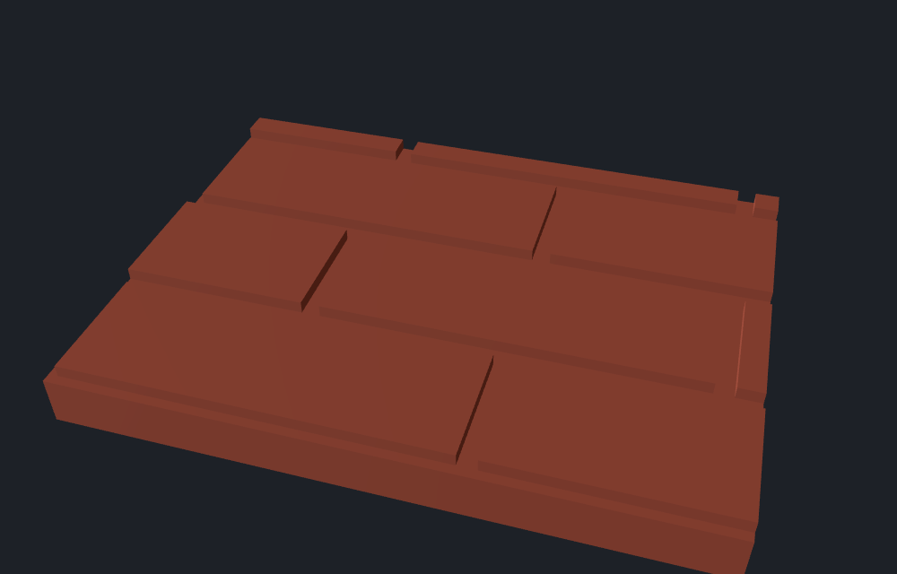
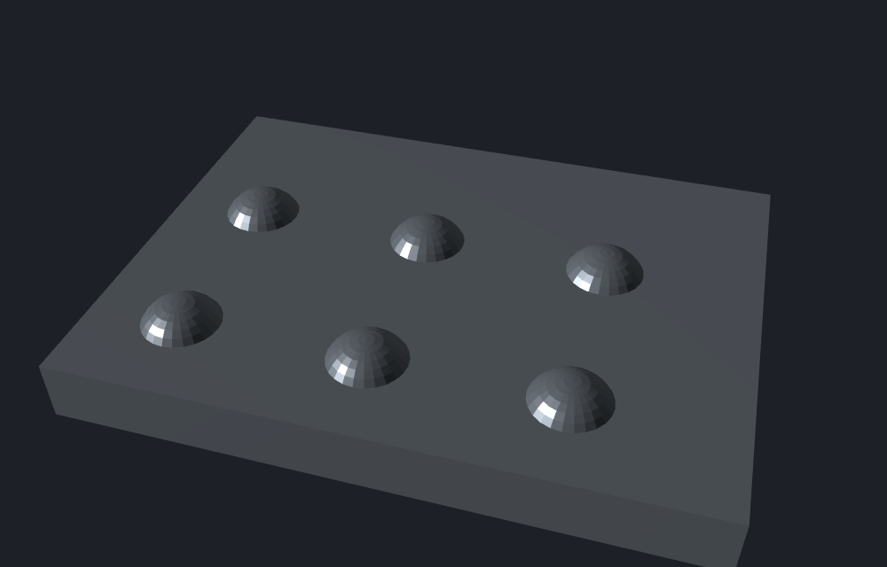
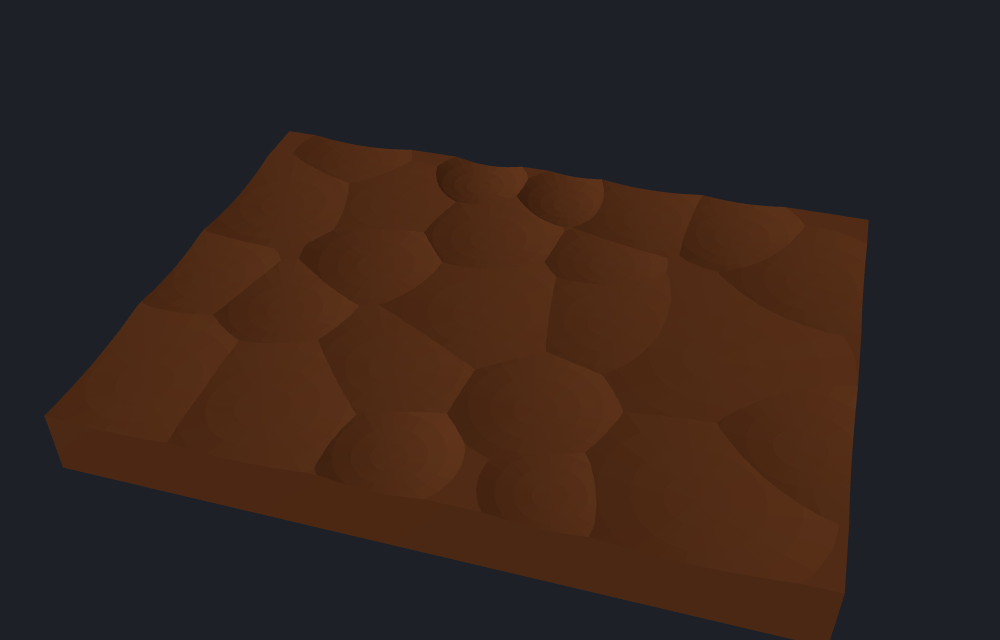

# Studio di fattibilità: Pattern in rilievo (mattoni, legno, ruggine, borchie, rame battuto)

Data: 17 ottobre 2026. Domanda: si può estendere il sistema Pattern, oggi solo sottrattivo e 2.5D (celle 2D estruse con una
sola profondità e tolte con una differenza), con **texture in rilievo** su una faccia piana: muro di mattoni, tavole di legno
con venature, lamiera arrugginita, borchie (additive) e rame battuto, mantenendo tempi da editor interattivo, il seme
deterministico e il codice OpenSCAD esportabile?

**Esito: fattibilità alta per mattoni, borchie e rame battuto (CSG), media per il legno (motore ibrido), media con una
condizione per la ruggine (mappa di altezze, export OpenSCAD pesante).** Il prototipo (solo studio, **non collegato
all'app**) calcola tutte e cinque le texture nel kernel, le scrive in OpenSCAD e il risultato di OpenSCAD coincide con quello
del kernel (verificato, vedi più sotto).

## Cosa c'è nel prototipo

| File | Contenuto |
|---|---|
| `src/scene/relief.ts` | Calcoli puri e deterministici: value noise con fBm (hash intero, nessuna tabella), layout dei mattoni e delle doghe, crateri della ruggine, centri delle borchie, martellate del rame (riusa `randomVoronoi`, `mulberry32`, `polygonCentroid`), funzioni di profondità e di quota, griglia di campioni `sampleGrid` |
| `src/kernel/relief.ts` | `reliefCutter(wasm, region, params, opts)` (texture da togliere), `reliefAddition(...)` (borchie, da unire), `heightSolid` (mappa di altezze chiusa in un solido), `BEST_ENGINE` |
| `src/codegen/reliefScad.ts` | `reliefScad(rect, params, engine, step)`: codice OpenSCAD del motore scelto |
| `src/scene/relief.test.ts`, `src/kernel/relief.test.ts` | 45 test: determinismo, validità (`NoError`, volume > 0, un solo solido), ruvidità della lamiera, volumi delle borchie, ritaglio sulla regione, codice OpenSCAD |
| `src/kernel/bench.test.ts` | In coda, dietro `BENCH=1`: tempi, triangoli, STL e codice OpenSCAD per ogni texture e motore |
| `docs/studio-rilievo/` | STL e immagini di esempio (pannello 40 × 30 × 4 mm, motore scelto) |

Tutte le funzioni lavorano nel **riferimento della faccia** (faccia su z = 0, pezzo sotto, come `cutterFor` in
`src/kernel/pattern.ts`) e ricevono la regione della faccia come `CrossSection` (già ridotta del margine), non la calcolano:
si potranno collegare dopo il branch che cambia la scelta della regione (campo `region` di `PatternParams`). L'opzione
`rect` ancora il disegno al rettangolo della faccia (`frameRect`), così i mattoni non si spostano quando cambia il margine.
Il chiamante possiede regione e solido restituito (`.delete()` come in `kernel/pattern.ts`).

## I due motori

**(a) CSG di celle.** Poligoni 2D (mattoni, doghe) composti con `CrossSection.compose` (nessuna booleana: le celle sono
disgiunte), sottratti alla regione per ottenere le fughe e estrusi una volta sola; calotte (martellate, crateri, borchie) per
**rivoluzione** di un profilo (`Manifold.revolve`) invece di `Manifold.sphere`, e unite in un'unica unione a lotto
(`Manifold.union`) o con `Manifold.compose` quando sono disgiunte (borchie). Vantaggi: bordi esatti, pochi triangoli dove la
forma è semplice, codice OpenSCAD di poche centinaia di byte. Limite: non si può scrivere una superficie continua e
irregolare (rumore).

**(b) Mappa di altezze.** Griglia regolare z = f(x, y) a passo 0,8 / 0,5 / 0,3 mm chiusa in un solido: i vertici sono quelli
della griglia più i 4 angoli del piano di chiusura, le pareti riusano gli indici dei vertici di bordo (mesh a tenuta senza
fusione di vertici, `status() === 'NoError'`, verificato nei test), poi si interseca con il prisma della regione. Per le
texture sottrattive la superficie sta a `0,02 − profondità` e il piano di chiusura a 1,5 mm sopra la faccia (dove la
profondità è sotto 0,02 mm la superficie resta sopra la faccia: niente facce complanari con il pezzo); per le borchie il
solido va da −0,2 mm (entra nel pezzo, nessuna fessura nell'unione) alla superficie. Vantaggi: qualunque funzione di altezza
(rumore, venature). Limiti: bordi a gradini (si vede la griglia), triangoli proporzionali all'area / passo², **codice OpenSCAD
proporzionale ai punti** (un `polyhedron` con tutti i valori).

OpenSCAD offre anche `surface(file = "...dat")`, ma richiede un file separato e rompe l'export in un file solo: scartato.
Non si può nemmeno ricalcolare il rumore dentro OpenSCAD: manca l'aritmetica intera (`Math.imul` del hash) e non
garantirebbe lo stesso disegno del kernel.

## Misure (faccia 80 × 60 mm su pannello di 5 mm)

Tempo mediano di 5 esecuzioni (più un giro di riscaldamento) di: costruzione del solido, booleana sul pannello ed estrazione
della mesh. Il portatile di sviluppo non era scarico: i tempi hanno circa ±30 % di rumore tra una prova e l'altra, i
triangoli e le dimensioni no. STL = 84 + 50 byte per triangolo (formato binario, come `writeStl`). Codice OpenSCAD = lunghezza
della stringa generata da `reliefScad`. Parametri: i predefiniti di `reliefDefaults`. Comando:
`$env:BENCH='1'; $env:BENCH_OUT='bench.txt'; npx vitest run src/kernel/bench.test.ts -t "texture in rilievo"`.

| Texture | Motore | Passo | Tempo (ms) | Triangoli | STL (KB) | OpenSCAD (KB) |
|---|---|---|---:|---:|---:|---:|
| Mattoni | **CSG** | | 5,8 | 456 | 22 | 0,3 |
| Mattoni | mappa | 0,8 | 81 | 2.688 | 131 | 40 |
| Mattoni | mappa | 0,5 | 149 | 6.596 | 322 | 100 |
| Mattoni | mappa | 0,3 | 402 | 18.222 | 890 | 274 |
| Legno | CSG (solo fughe, senza venatura) | | 2,3 | 196 | 10 | 0,6 |
| Legno | **ibrido** (fughe CSG, venatura mappa) | 0,8 | 148 | 17.450 | 852 | 43 |
| Legno | **ibrido** | 0,5 | 308 | 38.328 | 1.872 | 109 |
| Legno | ibrido | 0,3 | 780 | 98.772 | 4.823 | 297 |
| Legno | mappa (fughe incluse) | 0,8 | 167 | 15.908 | 777 | 43 |
| Legno | mappa | 0,5 | 155 | 37.862 | 1.849 | 110 |
| Legno | mappa | 0,3 | 376 | 100.460 | 4.905 | 300 |
| Ruggine | CSG (solo crateri, senza ruvidità) | | 258 | 27.002 | 1.319 | 4,6 |
| Ruggine | **mappa** | 0,8 | 53 | 15.338 | 749 | 46 |
| Ruggine | **mappa** | 0,5 | 121 | 38.916 | 1.900 | 114 |
| Ruggine | mappa | 0,3 | 336 | 107.500 | 5.249 | 312 |
| Borchie | **CSG** | | 36 | 10.192 | 498 | 0,3 |
| Borchie | mappa | 0,8 | 54 | 3.678 | 180 | 20 |
| Borchie | mappa | 0,5 | 123 | 7.436 | 363 | 47 |
| Borchie | mappa | 0,3 | 333 | 19.894 | 971 | 129 |
| Rame battuto | **CSG** | | 219 | 18.312 | 894 | 3,2 |
| Rame battuto | mappa | 0,8 | 54 | 15.700 | 767 | 46 |
| Rame battuto | mappa | 0,5 | 125 | 39.246 | 1.916 | 114 |
| Rame battuto | mappa | 0,3 | 340 | 107.284 | 5.239 | 312 |

Faccia grande (160 × 120 mm, 4 volte l'area, tre esecuzioni): rame battuto CSG circa 1.300 ms (73.000 triangoli), rame battuto
mappa 0,5 circa 800 ms (157.000), ruggine mappa 0,5 circa 600 ms (155.000), legno ibrido 0,5 circa 1.100 ms (151.000). Il
CSG del rame cresce con il numero di martellate (circa 95 su 80 × 60 mm, circa 380 su 160 × 120 mm), la mappa con l'area e con
1/passo²: **sulle facce grandi la mappa a 0,5 mm diventa più veloce del CSG per le calotte.**

**Verifica del codice OpenSCAD** (OpenSCAD 2025.11.30 con backend Manifold; tutti gli 11 casi mattoni, legno, ruggine, borchie
e rame in ogni motore, a passo 0,5 mm, pezzo = pannello 80 × 60 × 5 mm; il volume del solido esportato si misura sull'STL di
OpenSCAD): il volume coincide con quello del kernel, identico al decimo di mm³ in 8 casi su 11 (mattoni, legno, ruggine, rame in
mappa, borchie in mappa); ruggine CSG 21.481,9 contro 21.481,8, rame CSG 22.452,2 contro 22.451,5 e borchie CSG 24.566,5 contro
24.562,3 (differenze sotto lo 0,02 %, dovute ai numeri arrotondati a due decimali scritti nel codice). Tempo di rendering in
OpenSCAD tra 0,1 e 0,4 s per il CSG e circa 1 s per le mappe a 0,5 mm. Non si è verificato il ritaglio sulla regione (nel test
la regione è l'intera faccia).

### Scelta del motore per texture

| Texture | Motore | Perché |
|---|---|---|
| Mattoni | **CSG** | Sono rettangoli: bordi esatti, 456 triangoli, 0,3 KB di codice (due cicli `for`, nemmeno una lista di dati). La mappa dà la stessa forma con bordi a gradini, 12 volte i triangoli e 300 volte il codice. |
| Tavola di legno | **Ibrido** | Le fughe (0,8 mm) sono rettangoli: in CSG sono esatte, in mappa a 0,5 mm sarebbero larghe 1 o 2 celle e frastagliate. La venatura è un campo continuo (anelli deformati dal rumore) e solo la mappa lo esprime. L'ibrido unisce i due: costa quanto la mappa e ha fughe pulite. |
| Ruggine | **Mappa** | Non esiste una versione CSG fedele: la ruvidità frattale è il rumore stesso, e i soli crateri (258 ms, 27.000 triangoli) lasciano la faccia liscia, esattamente ciò che si vuole evitare. |
| Borchie | **CSG** | Disgiunte: `Manifold.compose` senza booleane, 36 ms, 0,3 KB (un `for` e un profilo). Sfaccettature controllabili con i segmenti. La mappa a 0,8 mm rende le calotte a scalini. |
| Rame battuto | **CSG** (mappa a 0,8 mm come anteprima) | Il CSG dà calotte esatte e 3 KB di codice; la mappa è 4 volte più veloce a 0,8 mm ma pesa 46 KB e le martellate sono meno nitide. Su facce grandi il CSG supera il secondo e conviene l'anteprima in mappa. |

Le sfere intere (`Manifold.sphere`) sono state scartate in partenza, senza misurarle: una calotta di raggio 4 mm e
profondità 0,5 mm ha un raggio di curvatura di 16 mm, quindi usarebbe solo una piccola parte di una sfera, mentre il resto
starebbe sopra la faccia. La rivoluzione dell'arco (4 anelli × 24 segmenti, circa 200 triangoli a calotta) è più leggera e
controllabile.

## Le cinque texture

Esempi in `docs/studio-rilievo/` (STL e PNG, pannello 40 × 30 × 4 mm, luce radente da sinistra per far risaltare il rilievo;
`RELIEF_SAMPLES=1 npx vitest run src/kernel/relief.test.ts -t esempi` rigenera gli STL).

### 1. Muro di mattoni

File di mattoni sfalsate di mezzo mattone, larghezza e altezza del mattone e spessore della fuga indipendenti, fughe incise. Il
mattone resta a quota 0 e la fuga scende di `depth`: la regione meno i rettangoli dei mattoni, estrusa una volta.

Parametri per la UI: **Larghezza mattone** (24 mm), **Altezza mattone** (8 mm), **Fuga** (1,2 mm), **Profondità fuga** (0,8 mm),
**Margine** (già esistente). Il layout parte dall'angolo del rettangolo della faccia e per ora non ruota (un campo **Angolo**
come quello degli esagoni richiederebbe di calcolare il layout nel rettangolo ruotato).

### 2. Tavola di legno

Doghe lunghe (`plankL` ± 15 %) con giunti sfalsati: ogni fila parte da un multiplo del passo aureo 0,382 della lunghezza più un
piccolo scarto casuale, quindi i giunti di file vicine non coincidono mai (test). Fughe tra le doghe e **venatura**: la fase degli
anelli è `u / distanza anelli + 3 · rumore lento lungo la doga + scostamento per doga` (anelli deformati), resa come creste
strette (coseno al cubo) e sommata a una fibra fine (value noise lungo 25 mm e largo circa 0,4 mm). Profondità da 0 a
`grainDepth` (frazioni di mm).

Parametri per la UI: **Larghezza doga** (12 mm), **Lunghezza doga** (60 mm), **Fuga** (0,8 mm), **Profondità fuga** (0,8 mm),
**Venatura** (profondità 0,25 mm; 0 = nessuna), **Distanza anelli** (3 mm), **Seme**.

### 3. Lamiera o ferro arrugginito

Profondità = **quota base** + ruvidità + crateri, ridotta dove ci sono scaglie. La ruvidità è fBm di value noise (4 ottave da
0,25 cicli/mm) di ampiezza ±`roughness`; i crateri (vaiolatura) sono conche a bordo liscio, raggio 0,6 a 2 mm e profondità 40 a
100 % del massimo, in posizioni casuali dal seme (`craterDensity` ogni 100 mm², cercati con cassetti spaziali); le
scaglie/pustole sono le zone in cui un rumore lento supera una soglia, e lì la profondità si riduce del 75 %, quindi restano
placche alte. **Tutta la faccia viene abbassata di circa `baseDepth`** (0,5 mm predefiniti) e la profondità non scende mai sotto
0,05 mm: serve una quota base perché il rilievo, che lavora solo per sottrazione, possa salire e scendere attorno a un livello
senza lasciare piani lisci. Il test misura la ruvidità (deviazione standard > 0,08 mm e oltre l'80 % dei campioni vicini diversi
di più di 1 µm).

Parametri per la UI: **Quota base** (0,5 mm), **Ruvidità** (0,35 mm), **Crateri ogni 100 mm²** (3), **Profondità crateri**
(0,5 mm), **Scaglie** (0 a 1, 0,4), **Seme**. Limite: a 0,5 mm di passo un cratere piccolo (diametro 1,2 mm) occupa 2 o 3
campioni e appare a scalini (si vede nell'immagine); a 0,3 mm migliora ma costa 107.000 triangoli e 5 MB di STL.

### 4. Borchie (additiva)

Griglia quadrata di borchie che parte a mezzo passo dall'angolo, solo i centri dentro il rettangolo; calotta sferica (altezza al
massimo pari al raggio, oltre ci sarebbe un sottosquadro) o cilindro con smusso. Il solido entra di 0,2 mm nel pezzo e va
**unito** (`Manifold.add`), non sottratto: è il solo modo additivo del prototipo, quindi `reliefAddition` è separato da
`reliefCutter`. Le borchie vengono ritagliate dalla regione (quelle sul bordo risultano tagliate: si può scegliere di scartarle).

Parametri per la UI: **Passo** (12 mm), **Raggio** (2,5 mm), **Altezza** (1,5 mm), **Forma** (calotta o cilindro), **Smusso**
(0,5 mm). Verificato: il volume aggiunto da 35 borchie a calotta è entro il 10 % di quello teorico (calotta sferica
π h (3 r² + h²) / 6), con entrambi i motori.

### 5. Rame battuto

Un Voronoi rilassato (`randomVoronoi`, regolarità 60) con una martellata per cella: centro = baricentro, raggio del bordo = 1,25
volte quello della cella (così si sovrappongono), raggio e profondità variati di ± `jitter` (25 %) con `mulberry32` in ordine
fisso (due estrazioni per cella). La profondità di un punto è la martellata più profonda tra quelle che lo coprono (la sfera
sotto il piano, `√(R² − d²) − (R − profondità)`), che coincide con l'unione dei solidi in CSG.

Parametri per la UI: **Diametro medio** (8 mm), **Profondità** (0,5 mm), **Variazione** (25 %), **Regolarità** (60 %), **Seme**.

## Stampabilità FDM (ugello 0,4 mm, strato 0,2 mm)

- **Rilievo minimo.** Sulla faccia superiore il rilievo è quantizzato in strati: 0,2 mm è un gradino, quindi sotto 0,4 mm
  (due strati) un rilievo si vede appena. Le venature a 0,25 mm sono visibili solo come un gradino sulla faccia superiore e
  vanno portate a 0,3 a 0,5 mm; la ruvidità della ruggine (±0,35 mm) è al limite ma funziona perché è irregolare; le martellate
  (0,5 mm su 4 mm di raggio) vengono a terrazze, che con strati da 0,1 mm o l'altezza strato variabile migliorano.
- **Faccia superiore o facce laterali.** Sulla faccia superiore la risoluzione verticale è lo strato (0,2 mm) e quella nel piano
  circa 0,4 mm: ottima per fughe, borchie e crateri, a scalini per le pendenze dolci. Su una faccia laterale (stampata in verticale) il
  rilievo si forma nel piano XY e la risoluzione è circa 0,1 a 0,4 mm: i dettagli fini (venatura, ruvidità) rendono meglio, ma si
  sovrappongono alle linee degli strati (0,2 mm), quindi la fibra della venatura va tenuta sopra i 0,3 mm di profondità.
- **Larghezze minime.** Una fuga si legge se è larga almeno 2 volte l'ugello (0,8 mm: valore predefinito delle fughe) e profonda
  almeno 0,4 mm; sotto circa 0,6 mm di larghezza tende a chiudersi. Per le borchie si consiglia un raggio di almeno 1 mm.
  Sono regole pratiche, non misurate in questo studio: vanno confermate con una stampa di prova.
- **Sbalzi delle borchie.** Sulla faccia superiore una calotta (altezza ≤ raggio) o un cilindro con smusso non hanno sbalzi:
  ogni strato è contenuto nel precedente. Su una faccia laterale le borchie sono sporgenze orizzontali: la metà superiore è uno
  sbalzo che oltre 45° dalla verticale richiede supporti o ponti. Suggerimento: per le facce laterali usare uno smusso grande
  (cono a 45°) o una calotta bassa (altezza minore di metà raggio). **Sulla faccia rivolta al piatto le borchie non si
  possono stampare** (il pezzo poggerebbe sulle borchie): orientare il pezzo con il rilievo additivo verso l'alto o di lato.
- **Orientamento.** Texture sottrattive (fughe, ruggine, rame) vanno bene verso l'alto e di lato. Sulla faccia rivolta al piatto
  la texture si imprime contro il piatto (finitura del piatto, primo strato schiacciato) e perde nitidezza. Sulla faccia
  superiore la qualità migliora con strati da 0,1 mm o altezza strato variabile e, per le superfici dolci, con la stiratura
  (ironing).
- **Dimensione dei file.** 5 MB di STL per 80 × 60 mm con mappe a 0,3 mm: ok per lo slicer, pesante per un progetto salvato
  (si salva solo la scena con i parametri, non la mesh) e per l'anteprima del worker (Comlink trasferisce i buffer).

## Codice OpenSCAD

Il motore scelto per texture scrive: mattoni, un ciclo `for` a due indici dentro un `difference() { square; ... }` estruso
(0,3 KB); doghe, l'elenco `planks` dei rettangoli (una riga per doga) e lo stesso schema (0,6 KB); borchie, un profilo e un
ciclo con `rotate_extrude` (0,3 KB); rame e crateri, un elenco `dents = [[x, y, r, d], ...]` (una riga per martellata) e un
modulo `dent(r, d)` che ricostruisce l'arco con la stessa formula del kernel (3,2 KB); ruggine e venatura, una
`zmap` con tutti i valori della griglia e un `polyhedron(pts, faces)` con `pts` e `faces` calcolati da cicli (46, 114 o 312 KB
a 0,8, 0,5 o 0,3 mm). Nel codice finale si userebbe come per i Pattern: `translate(origine) rotate(inverseEuler) { ... }` dentro un
`difference()` (o un `union()` per le borchie), con la regione (margine) fatta da `offset`/`projection` e intersecata con
`intersection()`. Nel prototipo il modulo `relief()` copre tutto il rettangolo e non ritaglia sulla regione (margine): l'`intersection()`
con `offset(delta = -margine) projection()` come in `patternLines` va aggiunta in integrazione (e verificata, vedi sopra).

Il vincolo vero è la ruggine: **un polyhedron da 114 KB a 0,5 mm è accettabile, da 312 KB a 0,3 mm no** (rende il `.scad`
poco leggibile e il rendering in OpenSCAD tocca il secondo). Mitigazione proposta: la ruggine esporta sempre a 0,5 mm di
passo, qualunque sia il passo usato per l'anteprima, e il codice porta un commento `construct:relief` con i parametri per
rigenerare la mappa.

## Come integrare nel sistema Pattern

1. **Tipi** (`src/scene/types.ts`): estendere `PatternParams.kind` con `'brick' | 'wood' | 'rust' | 'studs' | 'hammered'` e
   aggiungere un campo `relief?: ReliefParams` (l'unione discriminata del prototipo) oppure campi piatti come quelli esistenti
   (`size`, `wall`, ...). Il modo additivo si può dedurre dal tipo (borchie) o diventare un terzo valore di `mode`
   (`'add'`). Aggiungere anche `reliefAlgorithm: 1` (versione del rumore e delle liste casuali: se cambia il rumore, i vecchi
   progetti cambierebbero disegno, come per `PATTERN_ALGORITHM`).
2. **`normalizePattern`** (`src/scene/pattern.ts`): limitare ogni misura (passi, raggi, profondità, densità, numero di martellate
   ≤ 500, ecc.), usare il tipo `voronoi` come ripiego per un `kind` sconosciuto e **non toccare i progetti esistenti** (i nuovi
   campi sono opzionali con default).
3. **Kernel** (`src/kernel/pattern.ts`): estrarre da `cutterFor` il tratto "porta nel riferimento della faccia, calcola la
   regione, ridotta del margine" (è quello che cambia con il branch B) e farlo seguire da `reliefCutter` o `reliefAddition`;
   poi stessa rotazione e traslazione di ritorno dei cutter attuali. Per le borchie `buildPattern` fa
   `Manifold.union([risultato, ...aggiunte])` dopo la differenza degli altri tagli. Anteprima (`p.preview`): mappa a 0,8 mm e
   pochi segmenti. L'anteprima della ruggine e del rame sulle facce grandi usa sempre la mappa.
4. **Codegen** (`src/codegen/openscad.ts`, `patternLines`): per i `kind` nuovi chiamare `reliefScad` (già nello stesso
   riferimento di faccia) dentro `translate(origine) rotate(inverseEuler)`; per le borchie `union()` al posto di `difference()`.
5. **UI** (`PatternFields.tsx`): il selettore del tipo di Pattern (branch B) guadagna un gruppo "Rilievo"; i campi cambiano per
   tipo come per Voronoi e griglie. Un comando in più di barra richiede scorciatoia e tooltip, ma qui il comando è sempre
   Pattern: non serve.
6. **Test e documentazione**: gli stessi del prototipo (determinismo, validità, volumi), un test del codice OpenSCAD (il
   confronto con il volume del kernel si può fare in locale con `openscad`, non in CI) e un e2e per tipo.

## Limiti

- **Solo facce piane**, come il Pattern attuale (le facce inclinate funzionano per `faceFrame`): niente superfici curve, nessuna
  parametrizzazione UV.
- Il rilievo sulla faccia **ritaglia sulla regione** (cornice del margine intatta): le borchie sul bordo vengono tagliate.
- I mattoni hanno tutti la stessa altezza di rilievo: una variazione di rilievo per mattone (qualche decimo di mm) richiederebbe
  un'estrusione per mattone (circa 100 prismi: da misurare) oppure passare alla mappa.
- **Legno:** una sola specie di venatura (anelli di tavola segata tangenzialmente, senza nodi).
- **Ruggine:** la qualità dipende dal passo (scalini a 0,5 mm, vedi l'immagine) e il codice OpenSCAD è grande.
- **Stabilità nel tempo:** rumore, ordine delle estrazioni e arrotondamento a 0,01 mm sono parte del formato: vanno bloccati con
  un campo di versione (punto 1).

## Raccomandazione

Rilasciare in quattro tappe, dalla più sicura alla più costosa, ognuna con una versione minor di Construct:

1. **Mattoni e borchie** (la prima è sottrattiva, la seconda introduce il **modo additivo**): CSG puro, tempi sotto 40 ms,
   codice OpenSCAD di 0,3 KB, nessun rischio di compatibilità. Include tutto il lavoro di integrazione (tipi, normalize, branch
   additivo in `buildPattern`, `patternLines`, UI). **Stima: 3 a 4 giorni** (2 per l'integrazione e il modo additivo, 1 per ogni
   texture con test e documentazione).
2. **Rame battuto** (CSG, anteprima in mappa a 0,8 mm sulle facce oltre circa 100 × 80 mm): 219 ms su 80 × 60 mm. **Stima:
   1,5 giorni** (la mappa di altezze come anteprima si può rimandare).
3. **Tavole di legno** (ibrido): richiede `heightSolid` e `sampleGrid`, già nel prototipo. **Stima: 2 giorni**, più la
   decisione sui parametri della venatura guardando stampe reali.
4. **Ruggine** (mappa di altezze): **da rilasciare solo dopo aver deciso l'export OpenSCAD** (114 KB a 0,5 mm, commento con i
   parametri, passo fisso) e dopo una prova di stampa: il valore estetico è alto, il rischio di un `.scad` ingombrante e di
   texture poco leggibile a 0,4 mm di ugello è reale. **Stima: 2 a 3 giorni.**

Totale circa **9 a 10 giorni** per le cinque texture, di cui circa 2 per l'integrazione e il modo additivo, che
conviene fare **dopo** che il branch B ha chiuso la scelta della regione e del selettore del tipo, per non rifare due volte
`cutterFor`, `normalizePattern` e `PatternFields`.

Prima di partire con la tappa 1 servono due decisioni: se la **profondità** del rilievo si espone come parametro di ogni
texture (come nel prototipo) oppure riusa `depth`/`sides` del Pattern (nei rilievi `sides: 'both'` ha poco senso), e se la
fuga di mattoni e doghe vale in ogni caso minimo 0,8 mm con un avviso come per la parete del Voronoi.

## Domande aperte

- Il rilievo si applica a una faccia sola o a più facce come il Pattern attuale (ognuna con il suo seme)? Il prototipo lavora
  su una faccia alla volta: con più facce basta ripetere la chiamata con `seed + indice`.
- Va bene che le borchie sul bordo vengano tagliate dalla regione, o conviene scartarle?
- Per la ruggine si accetta la quota base (0,5 mm) che abbassa tutta la faccia?
