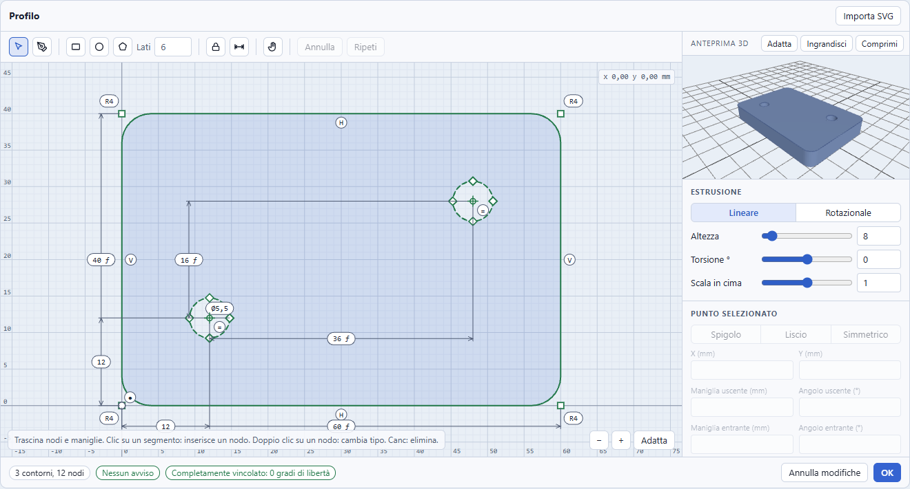
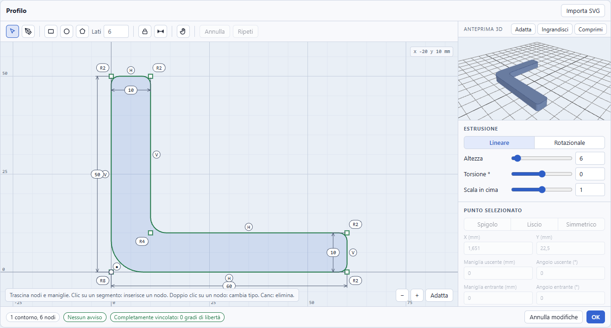
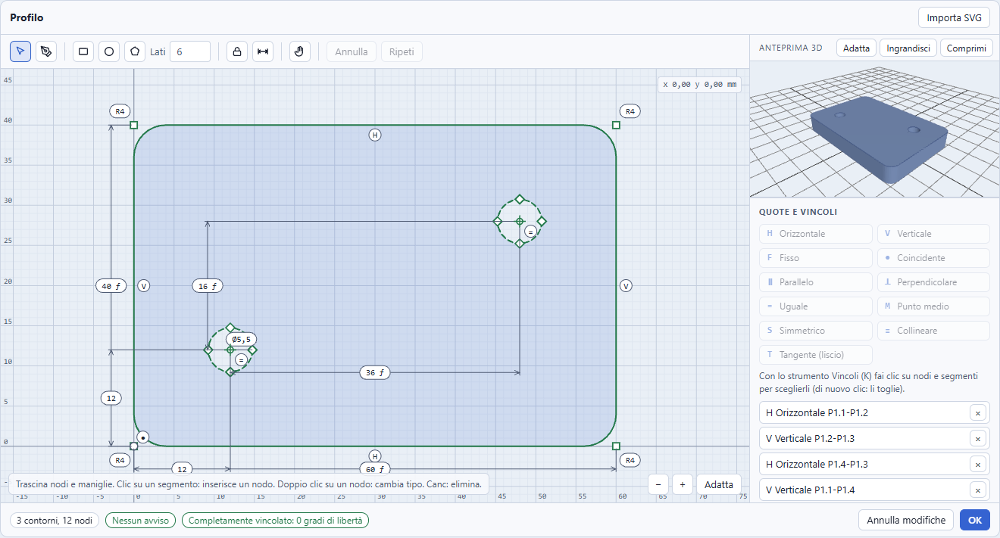
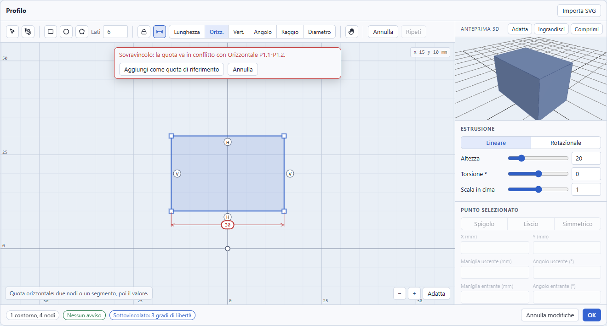
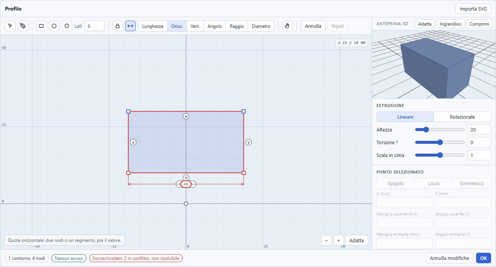
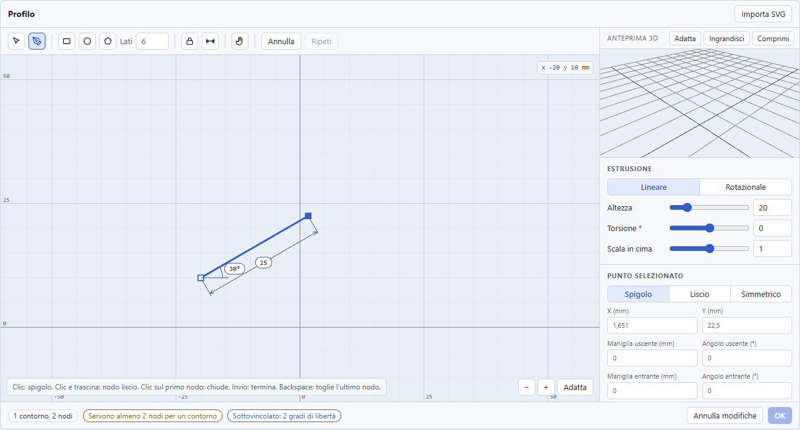
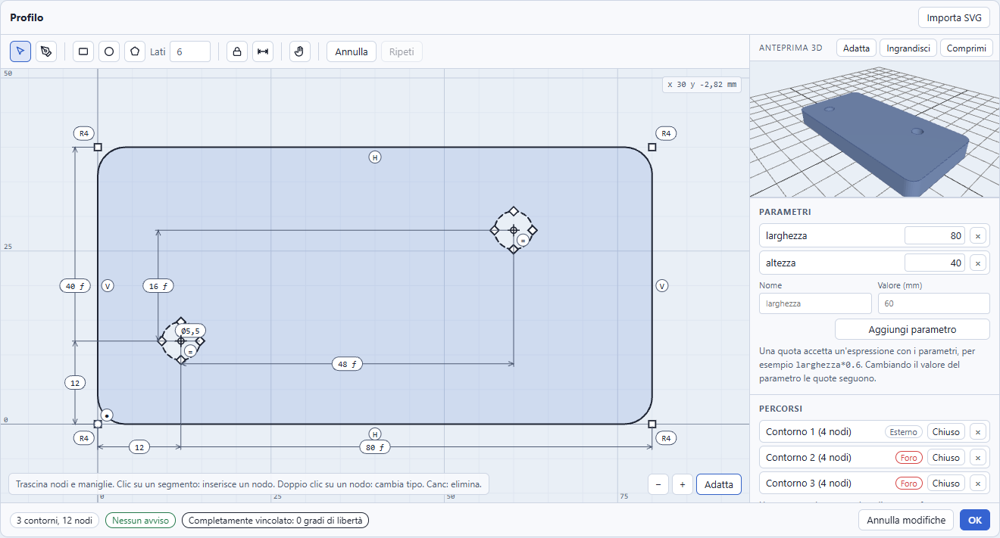
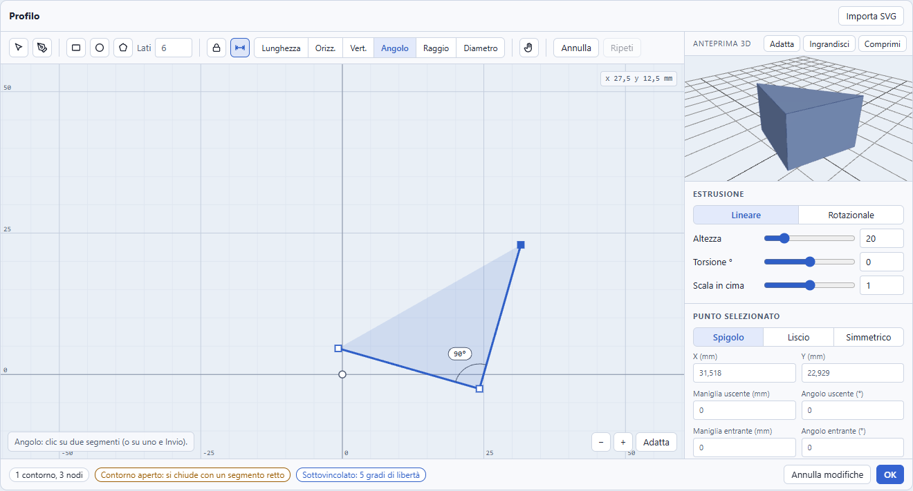
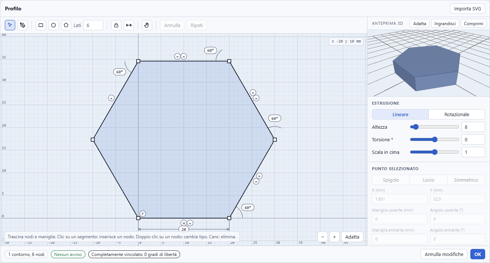

# Studio di fattibilità: quote e vincoli nella modale del Profilo (in stile Fusion 360)

Data: 23 ottobre 2026, sulla versione 0.71.0. Domanda: si possono aggiungere alla modale del Profilo **quote** (lunghezze, distanze
orizzontali e verticali, angoli, raggi) e **vincoli** (orizzontale, verticale, parallelo, uguale, fisso...) per ottenere profili
**precisi**, come in Fusion 360, con un risolutore scritto in casa, senza rompere il modello dei nodi di Bézier, il salvataggio, il
codice OpenSCAD e la cronologia di Annulla?

**Esito: fattibilità alta per un primo blocco** (quote di lunghezza, orizzontale, verticale e angolo; vincoli orizzontale, verticale,
fisso, coincidente, parallelo, perpendicolare, uguale, punto medio, simmetrico, collineare; raccordo con raggio per nodo; stato dei
gradi di libertà con i tre colori), **media** per il cerchio quotato (diametro dei fori) e per le espressioni con parametri, **bassa
e rimandata** per l'arco vero, la curvatura continua e i vincoli sulle maniglie delle curve. Il risolutore proprio (Levenberg-Marquardt
a norma minima, circa 450 righe di TypeScript con i commenti, senza dipendenze) soddisfa i cinque criteri misurati: rettangolo a 0 gradi di libertà, vincolo
in più segnalato senza oscillazioni, trascinamento a spostamento minimo, tempi da editor interattivo (mediana sotto 4 ms per un
fotogramma di trascinamento con 100 segmenti, nel browser sotto 1,5 ms nel caso peggiore con le quote ogni due lati) e casi limite
gestiti. **Una riserva**: la diagnosi completa (rango dello Jacobiano) costa 36 ms di mediana a 100 segmenti completamente quotati
(70 ms nel peggiore): va tenuta fuori dal ciclo di trascinamento (dopo il rilascio o in un momento di quiete).

Il lavoro vero non è il risolutore ma il **modello dati**: oggi i nodi non hanno identità, e un vincolo che cita un nodo per posizione
nell'elenco si rompe al primo inserimento o cancellazione. Servono id stabili dei nodi, e da lì discendono il formato del commento
`// construct:path` (da `v:1` a `v:2`), la whitelist di `sanitizePaths`, la bozza in `localStorage` e le azioni dello store.

Il prototipo interattivo è in [`docs/prototipi/profilo-quote.html`](prototipi/profilo-quote.html) (si apre con un doppio clic; l'anteprima
3D scarica `three.js` da jsDelivr, quindi serve la rete, il disegno funziona comunque). È una **copia estesa** di
[`profilo-bezier.html`](prototipi/profilo-bezier.html), che resta intatto. Vale la pena provarlo prima di leggere la sezione 5.



## Che cosa c'è nel prototipo e nel nucleo

| File | Contenuto |
|---|---|
| `src/ui/ProfileEditor/constraints.ts` | Il **nucleo del risolutore**: funzioni pure, nessun import, 14 tipi di vincolo e quota, `solveSketch` (risoluzione e diagnosi), `measure`, `validateValue`, `maxResidual`. **Non collegato all'app** |
| `src/ui/ProfileEditor/constraints.test.ts` | 23 test: i criteri a-e, ogni tipo di vincolo, i casi limite, la coincidenza del blocco `CORE` del prototipo con il modulo |
| `docs/prototipi/profilo-quote.html` | Il prototipo: blocco `CORE-BEGIN` / `CORE-END` generato dal modulo, strumenti Quota (D) e Vincoli (K), cerchio parametrico, raccordo per nodo, parametri ed espressioni, Penna con lunghezza e angolo digitati, tre esempi quotati |
| `scripts/constraints-core.mjs`, `scripts/constraints-sync.mjs` | Tolgono i tipi da `constraints.ts` (con `stripTypeScriptTypes` di `node:module`, perché TypeScript 7 non ha più l'API JavaScript) e scrivono o verificano il blocco `CORE` del prototipo |
| `scripts/constraints-bench.mjs` | Misura i criteri a-e **estraendo il blocco `CORE` dal prototipo** (il codice provato è quello della pagina) e stampa le tabelle di questo documento |
| `scripts/quote-prototype-check.mjs` | Apre il prototipo in Chrome con Playwright (`file://`, nessun server): 38 controlli sui gesti, nessun errore in console, e le immagini `docs/images/profilo-quote-*.png` |
| `docs/prototipi/misure-quote.txt` | L'uscita dello script di misura, con la versione di Node |

Il prototipo parte da `profilo-bezier.html` e non lo riscrive: stesso stile e stessi token, gli stessi strumenti (Penna, Seleziona, forme
base, import SVG), con le aggiunte descritte in 5.

## 0. Che cosa si intende per «quota» in questo studio

Nel repository la parola ha già **tre significati** (vedi «Segnalazioni»): la quota di sezione del Profilo con sagoma (la Z a cui si
taglia il profilo), le etichette X, Y e Z dell'ingombro in `DimensionOverlay.tsx`, e la distanza tra oggetti di `docs/da-fare.md`.
Qui si usano questi termini, e solo questi:

- **Quota**: una misura che il disegno deve rispettare, scelta dall'utente e mantenuta dal risolutore: lunghezza (allineata),
  distanza orizzontale, distanza verticale, angolo, raggio, diametro. Sta dentro la modale e vale per i nodi del disegno.
- **Quota pilotante**: impone la misura al disegno. **Quota di riferimento** (tra parentesi): mostra la misura attuale, non la impone.
- **Vincolo**: una relazione geometrica senza numero (orizzontale, parallelo, uguale, fisso...).
- **Grado di libertà**: una coordinata che il disegno può ancora cambiare senza violare quote e vincoli.
- **Sottovincolato** (ancora libero), **completamente vincolato** (0 gradi), **sovravincolato** (un vincolo è ridondante o in conflitto).

## 1. Come lo fa Fusion 360

Fonti consultate (le affermazioni sono distinte per grado di verifica, vedi sotto): la pagina Autodesk dei vincoli
([SKT-CONSTRAINTS](https://help.autodesk.com/cloudhelp/ENU/Fusion-Sketch/files/SKT-CONSTRAINTS.htm), letta per intero), la pagina sulle
linee ([SKT-CREATE-LINES](https://help.autodesk.com/cloudhelp/ENU/Fusion-Sketch/files/SKT-CREATE-LINES.htm), solo il riassunto del
motore di ricerca), il blog Autodesk sulle quote
([dimensions in sketches](https://www.autodesk.com/products/fusion-360/blog/dimensions-in-sketches-fusion/), riassunto del motore di
ricerca), il forum Autodesk sulle quote di riferimento
([dimensions](https://forums.autodesk.com/t5/fusion-design-validate-document/dimensions/m-p/6711716)) e sul colore dei vincoli
([sketch defined or constraint versus fixed](https://forums.autodesk.com/t5/fusion-design-validate-document/sketch-defined-or-constraint-versus-fixed/m-p/6784960),
[sketch offset not fully constrained](https://forums.autodesk.com/t5/fusion-design-validate-document/sketch-offset-not-fully-constrained/m-p/7313487)),
sempre riassunti dal motore di ricerca. **Non ho usato Fusion**: ciò che segue è diviso in «dalle fonti» e «dalla mia conoscenza, non
verificato».

### Quote

| Tipo | Come lo fa Fusion | Verifica |
|---|---|---|
| Lineare: allineata, orizzontale, verticale | Strumento Sketch Dimension: due punti o un segmento; la posizione dell'etichetta, oppure il clic destro prima di confermare, sceglie orizzontale, verticale o allineata | Dalle fonti (blog) |
| Angolare | Due segmenti (o tre punti) | Dalle fonti (blog) |
| Raggio e diametro | Su arco e cerchio; si passa dall'uno all'altro con il clic destro | Dalle fonti (blog) |
| Quota guida (pilotante) e di riferimento | Una quota in più su uno schizzo già vincolato diventa di **riferimento**, mostrata **tra parentesi** e non modificabile | Dalle fonti (forum) |
| Valore digitato subito | Alla creazione si apre un campo, Invio conferma, Esc annulla | Dalla mia conoscenza |
| Parametri utente ed espressioni | Il campo della quota accetta espressioni e nomi di parametri utente (per esempio `larghezza/2`) | Dalla mia conoscenza (non trovato nelle fonti lette) |

### Vincoli

La pagina Autodesk elenca **dodici** vincoli: Orizzontale/Verticale (uno solo, sceglie l'asse più vicino), Coincidente, Tangente, Uguale,
Parallelo, Perpendicolare, Fisso/Sblocca, Punto medio, Concentrico, Collineare, Simmetria e Curvatura (continuità G2 di una spline con
un'altra curva).

| Vincolo Fusion | Nel prototipo | Nota |
|---|---|---|
| Orizzontale/Verticale | Sì, due pulsanti (la scelta automatica dell'asse non c'è) | Su un segmento o su due nodi |
| Coincidente | Sì, tra due nodi | Nodo su curva: non c'è |
| Tangente | **Non come vincolo**: pulsante «Tangente (liscio)» che imposta il tipo Liscio | Vedi sezione 2 |
| Uguale | Sì, tra due segmenti (stessa lunghezza) | Anche tra due raggi di cerchio |
| Parallelo, Perpendicolare | Sì | Sul segmento, non sulle maniglie |
| Fisso | Sì | Vale anche per l'origine, sempre ferma |
| Punto medio | Sì | Un nodo e un segmento |
| Collineare | Sì | Due segmenti sulla stessa retta |
| Simmetria | Sì | Due nodi e un segmento (l'asse) |
| Concentrico | **No** | Serve il cerchio come entità, vedi sezione 2 |
| Curvatura (G2) | **No** | Servirebbero le maniglie come variabili |

### Stato, colori e deduzioni

- **Colori dello stato**: sottovincolato blu, completamente vincolato nero, sovravincolato rosso con proposta di quota di riferimento.
  *Dalla mia conoscenza, non verificato*: le fonti trovate confermano solo che il colore dipende dall'opzione «Color sketch geometry
  based on constraint status» e che le parentesi indicano una quota di riferimento; non ho trovato una fonte che dia i tre colori.
  Il prototipo usa **blu, verde e rosso** (il nero sullo sfondo scuro sparirebbe) e in più un testo nel piede, perché il colore non
  basta (vedi Accessibilità, sezione 5).
- **Vincoli dedotti durante il disegno**: la pagina «Automatically apply sketch constraints while creating sketch curves» esiste nel
  manuale, ma ho letto solo il titolo. *Dalla mia conoscenza, non verificato*: Fusion mostra un'icona vicino al cursore e applica
  orizzontale, verticale, tangente, coincidente quando il tratto si allinea.
- **Lunghezza e angolo digitati durante la linea**: la pagina sulle linee dice che si possono specificare lunghezza e angolo prima
  di fare clic sul secondo punto. **Tab per passare da un campo all'altro non è confermato** da nessuna fonte trovata; *dalla mia
  conoscenza* in Fusion i campi appaiono dopo il primo punto, Tab li alterna, Invio conferma, e i valori diventano quote.
- **Fusion rifiuta** un vincolo che renderebbe lo schizzo sovravincolato e propone la quota di riferimento (conoscenza, coerente con il
  forum letto). Il prototipo fa lo stesso (sezione 5).

## 2. Decisione sugli archi: raggio, tangente e cerchio

Construct ha **solo cubiche di Bézier**: non esiste il segmento «arco». Fusion invece quota raggi e diametri perché ha archi e cerchi
veri. Le strade, valutate sul prototipo:

| Opzione | Che cosa si può quotare | Costo | Rischio |
|---|---|---|---|
| **A. Solo rette, nodi e maniglie**, con il **raggio di raccordo come proprietà del nodo** | Lunghezze, distanze, angoli, raggio di uno spigolo arrotondato | Basso: un campo `r` sul nodo | Un cerchio non ha diametro |
| **B. Arco vero** (nuovo tipo di segmento con centro e raggio) | Tutto, compresi tangente vera e concentrico | Alto: nuovo tipo di segmento in `bezier.ts`, kernel, codegen, import SVG (gli archi `A` oggi diventano cubiche), `resize.ts`, doppia rappresentazione | Il formato cambia in profondità; ogni tipo di nodo e segmento va gestito in kernel e codegen |
| **C. Solo il cerchio come entità minima** (centro e un punto sul bordo), per i fori | Diametro, posizione del centro, uguale, concentrico (tra cerchi) | Medio | Resta un'eccezione: si salva come 4 nodi simmetrici più i due punti |

**Raccomandazione: A subito, C in una tappa successiva, B no (per ora).** Motivi:

1. A basta per profili precisi di piastre, staffe, profilati: le lunghezze si quotano, e il raccordo si **digita** (come in
   `docs/studio-profili-bezier.md:390`, «Raggio di raccordo per nodo»).
2. Il caso che A non copre, il foro rotondo con il suo diametro, è il più frequente nella stampa 3D (viti, perni). Il **cerchio
   parametrico di C** costa poco perché **non richiede nessun tipo di vincolo nuovo**: il cerchio è il punto centrale più un punto
   sul bordo, il raggio è una quota di **lunghezza** tra i due, e i tre nodi restanti sono derivati (`regenCircle` nel prototipo).
   Un vincolo nascosto «orizzontale» tiene fermo l'angolo del punto sul bordo, così restano esattamente 3 gradi di libertà (x, y,
   raggio). Nel prototipo la piastra ha due fori con il diametro quotato, la posizione dei centri quotata e un vincolo «Uguale» tra i
   raggi, e arriva a 0 gradi di libertà.
3. L'arco vero (B) obbliga a toccare kernel, codegen e import SVG: non è giustificato finché non lo chiede qualcuno.

### Raggio di raccordo per nodo

Il nodo di tipo Spigolo, senza maniglie e con un segmento prima e uno dopo, ha un campo opzionale `r` (mm). **Il risolutore e le
quote vedono sempre lo spigolo vivo** (l'intersezione dei due segmenti); solo il disegno e il solido sono arrotondati: il nodo si
espande in due punti di tangenza e una cubica (`filletGeom` nel prototipo: `t = r / tan(θ/2)`, maniglie `4/3 · tan((π − θ)/4) · r`,
con il limite a metà del segmento più corto, così due raccordi vicini non si sovrappongono). Il raggio digitato oltre il limite si
riduce con un avviso. Conseguenze per il codice vero: `samplePaths` e `segmentOf` in `src/scene/bezier.ts` devono espandere i
raccordi prima di campionare; `sanitizePaths` (riga 271) **scarta ogni campo non in whitelist**, quindi `r` va aggiunto lì e validato
(finito, `≥ 0`, entro `MAX_COORD`); il codice OpenSCAD continua a scrivere i soli punti campionati e il commento `construct:path`
porta `r`.



### Tangente e tipo di nodo: oggi un vincolo applicato durante la modifica, non un dato

Lo studio sul Bézier (`docs/studio-profili-bezier.md:93-95`) dice che «i tipi sono un vincolo applicato durante la modifica, non un
dato da ricalcolare in lettura: le maniglie salvate sono sempre quelle vere». In altre parole `smooth` e `symmetric` non vengono mai
**ri-imposti** quando si apre il file: la forma dipende solo da `p`, `in`, `out`. È una scelta robusta (un file si legge identico in
ogni versione) e il prototipo la mantiene: **tangente = nodo Liscio**, applicato una volta quando si preme il pulsante.

Se invece la tangente diventasse un **vincolo persistente** (come in Fusion), servirebbe ribaltare quella decisione:

- le maniglie diventano **variabili del risolutore** (un punto per maniglia, `id.in` e `id.out`), il tipo `smooth` equivale a
  `collinear(in, nodo, out)` e `symmetric` a `midpoint(nodo, in, out)` (entrambi già presenti nel nucleo);
- il `kind` diventa un dato **derivato** dai vincoli, non più l'impostazione scelta dall'utente;
- il numero di variabili cresce (da 2 a 6 per nodo) e il costo del risolutore con lui; il tempo di risoluzione a 100 segmenti
  densamente vincolati è già 3,5 ms (tabella d), con le maniglie crescerebbero variabili ed equazioni e il tempo andrebbe rimisurato;
- un file con vincoli di tangente andrebbe **ri-risolto in lettura** per essere coerente, oppure si salvano le soluzioni e i
  vincoli si ri-risolvono solo alla prima modifica (la scelta consigliata anche per le quote, sezione 3).

**Raccomandazione**: non ribaltare, per ora. Il pulsante «Tangente (liscio)» resta un'azione sul tipo di nodo, e la tangente quotata
tra segmento e arco si ottiene con il **raggio di raccordo** (che è già tangente per costruzione). I vincoli sulle maniglie sono la
tappa 6, solo a richiesta.

## 3. Modello dati

### Id stabili dei nodi

Oggi un nodo si identifica per posizione (`NodeRef { path, node }` in `model.ts`): inserire un nodo (`insertNode`) o cancellarne uno
(`deleteNodes`) sposta tutti gli indici seguenti. Un vincolo non può riferirsi a indici. **Serve un `id` su ogni nodo.** Il prototipo
usa un contatore (`n1`, `n2`...) e lo assegna in un solo punto (`ensureIds`, chiamata a ogni `commit` e a ogni risoluzione), così gli
strumenti di creazione non cambiano.

```ts
interface PathNode { id: string; p: Vec2; in?: Vec2; out?: Vec2; kind: 'corner' | 'smooth' | 'symmetric'; r?: number }
interface PathContour { closed: boolean; nodes: PathNode[]; circle?: { id: string; c: Vec2 } }  // circle: tappa 5

type ConstraintType = 'fixed' | 'horizontal' | 'vertical' | 'coincident' | 'dist' | 'distX' | 'distY' | 'angle'
                    | 'parallel' | 'perpendicular' | 'equal' | 'midpoint' | 'collinear' | 'symmetric';
interface Constraint {
  id: string; t: ConstraintType;
  p: string[];            // id dei punti, nell'ordine richiesto dal tipo: un segmento è la coppia (a, b)
  v?: number;             // valore di una quota: mm, oppure gradi per l'angolo
  s?: 1 | -1;             // verso di distX e distY (la distanza orizzontale è con segno rispetto alla configurazione di partenza)
  x?: number; y?: number; // punto in cui un nodo è fisso
  ref?: true;             // quota di riferimento: si mostra, non entra nel risolutore
  expr?: string;          // espressione con i parametri (tappa 5)
  rad?: 1; dia?: 1;       // la quota di un cerchio si legge come raggio o come diametro
}
// Draft e variante 'path' del nodo: constraints?: Constraint[]; params?: { name: string; value: number }[]
```

**Riferimenti.** Nodi: l'id. Segmenti: la **coppia di id** dei due estremi (non esiste un id di segmento: i segmenti nascono e muoiono
con i nodi). Maniglie, se un giorno servono: id derivato `nodo.in` e `nodo.out`. L'origine dell'editor è un punto speciale `O`, sempre
fermo: in rotazione è il punto sull'asse, e una quota di distanza orizzontale da `O` è la **distanza dall'asse** digitabile, la misura
che oggi si legge solo nella coordinata X del nodo.

**Che cosa succede ai vincoli quando il disegno cambia** (da decidere, vedi sezione 7): cancellando un nodo i vincoli che lo citano
spariscono nello stesso passo (`pruneCons` nel prototipo); inserendo un nodo su un segmento vincolato, la proposta è che orizzontale,
verticale, parallelo, uguale passino ai due nuovi segmenti e che le quote di lunghezza restino tra i due estremi originali, dove
continuano a essere vere (il prototipo oggi lascia il vincolo sulla coppia originale).

### Ripercussioni sul codice esistente

| Dove | Che cosa cambia |
|---|---|
| `src/scene/types.ts`: `PathNode` (103-108), `PathContour` (111-114), `Draft` (117-128), variante `kind: 'path'` (236-251) | Campi nuovi: `id`, `r` sui nodi; `circle?` sul contorno; `constraints?` e `params?` su `Draft` e sul nodo. Tutti opzionali |
| `src/scene/bezier.ts`: `sanitizePaths` (271) | È una **whitelist**: ogni campo in più viene scartato. Va aggiunta la lettura di `id` (stringa breve, unica nel contorno), `r`, `circle`; più una `sanitizeConstraints` (tipo noto, numero di punti giusto, id esistenti, numeri finiti e `v` positivo per le lunghezze, tetto di 1000 vincoli) |
| `encodePathMeta` / `decodePathMeta` (304 / 309) | Da `{ v: 1, ... }` a `{ v: 2, ..., k: vincoli, q: parametri }`. La lettura accetta `v` 1 e 2: un `v:1` si legge come oggi (gli id si assegnano in lettura, nessun vincolo). Un'app vecchia davanti a un `v:2` restituisce `null` (`v !== 1`): il poligono torna un Poligono qualsiasi, come per un commento rovinato. Comportamento corretto, ma va detto nelle note di versione |
| `src/scene/store.ts`: `roundPaths` (133) | Oggi arrotonda a 4 decimali. Vedi sotto: si arrotonda **dopo** la soluzione |
| `addPath` (338), `commitProfile` (365-395) | La `patch` e il `Draft` portano `constraints` e `params`; `compensatePosition` e `pathNaturalSize` non cambiano. Resta un solo `act('Profilo')`: **un'operazione utente, un passo** |
| `src/ui/ProfileEditor/draft.ts` | La bozza in `localStorage` passa da `v:1` a `v:2`; `loadDraft` valida anche vincoli e parametri e accetta le bozze `v:1` |
| `src/codegen/openscad.ts` (riga 230) e `src/import/scad/pathMeta.ts` | Il commento `// construct:path` porta i vincoli. `restorePath` confronta i punti campionati con quelli scritti: gli id non entrano nel confronto |
| `src/ui/ProfileEditor/history.ts` | La cronologia locale salva il `Draft` intero (contorni, vincoli, parametri). Una **risoluzione fa parte della stessa operazione**: aggiungere una quota è un passo, trascinare un nodo è un passo al rilascio (come oggi), non un passo per ogni fotogramma |

### Peso del commento `// construct:path`

Misurato sugli esempi del prototipo (JSON compatto, coordinate a 4 decimali; nella piastra anche i nodi derivati dei due cerchi):

| Esempio | Nodi | Vincoli | Nodi oggi (B) | Nodi con id e `r` (B) | Vincoli (B) | Parametri (B) |
|---|---|---|---|---|---|---|
| Piastra con due fori | 12 | 15 | 753 | 909 | 879 | 55 |
| Staffa a L | 6 | 11 | 203 | 305 | 553 | 2 |
| Esagono regolare | 6 | 11 | 222 | 288 | 615 | 2 |

Gli id costano circa il 20-50% sui nodi (10 byte a nodo), un vincolo circa 55-60 byte. Per la piastra il commento passa da 0,75 a
circa 1,8 KB, un'inezia rispetto ai punti campionati che lo seguono. Se servisse, si può scrivere il vincolo in forma di array
(`["dx","n1","n2",60]`, circa 25 byte) e il risparmio è di oltre la metà; non conviene prima di aver visto un caso reale.

### Arrotondamento: dopo la soluzione

`roundPaths` arrotonda a 4 decimali perché il codice OpenSCAD fa lo stesso. Con le quote il rischio è che l'arrotondamento **rompa la
quota** (una lunghezza di 60 diventa 59,99995). Si arrotonda quindi i punti **dopo** la soluzione (come oggi), e il valore `v` della
quota si salva **esatto**. Errore residuo misurato dopo l'arrotondamento a 4 decimali di tutti i punti: **0,000084 a 0,000093 mm** su
catene da 10, 50 e 100 segmenti con lunghezze e angoli irrazionali (tabella in 4), cioè sotto la metà dell'ultimo decimale. Si può
accettare un residuo fino a **0,0002 mm** senza segnalare nulla. La politica proposta: **alla lettura non si risolve** (le coordinate
salvate sono già la soluzione); alla prima modifica si risolve, e i punti si spostano di meno di 0,0001 mm.

## 4. Il risolutore

### Levenberg-Marquardt proprio contro planegcs

| Criterio | Risolutore proprio (`constraints.ts`) | planegcs (`@salusoft89/planegcs` 1.1.7, porta WASM del solver 2D di FreeCAD) |
|---|---|---|
| Licenza | Nostra, **MIT** come Construct | **LGPL-2.0-or-later** (campo `license` del `package.json`, letto da jsDelivr). Un WASM incluso nel bundle impone di rendere disponibili i sorgenti della libreria e di consentire la sostituzione: va chiarito con chi ha deciso la licenza MIT |
| Peso | Circa 20 KB di sorgente con i commenti (circa 11 KB di codice), nessun file binario | `planegcs.wasm` **508.141 byte** più 28 KB di glue JavaScript (elenco dei file di jsDelivr): confrontabile con il WASM di manifold (circa 540 KB) che Construct già porta |
| Vincoli | I 14 del nucleo (sezione 1) | Tutti quelli di FreeCAD (coincidente, distanza, angolo, tangente, arco, ellisse, parabola...); il README non ne dà l'elenco |
| Primitive | Solo punti | Punto, linea, cerchio, arco, ellisse e coniche. **B-spline non ancora complete** (README) |
| Web Worker | Funzioni pure, vanno ovunque | WASM caricabile in un worker, ma **nessun multithreading** (README) e «con Vite occorre impostare l'URL del `.wasm`» |
| Determinismo | Totale: nessun numero casuale, stessi dati stessi risultati | Non verificato: dipende da DogLeg (predefinito), Levenberg-Marquardt, BFGS, SQP, e dall'ordine dei vincoli |
| Diagnosi dei gradi di libertà e dei conflitti | `dof`, punti liberi, vincoli ridondanti e in conflitto, dal rango (vedi sotto) | *Dalla mia conoscenza di FreeCAD, non verificato*: il motore GCS dà gradi di libertà e vincoli in conflitto o ridondanti; non ho letto l'API del wrapper |
| Costo di integrazione | Circa 450 righe già scritte e provate | Wrapper, conversione dei dati dal nostro modello, test |

**Raccomandazione: risolutore proprio**, come scelto dall'utente. planegcs resta come termine di confronto: **non l'ho eseguito**, quindi
nessun numero di tempo o di robustezza è confrontato. Il motivo per ripensarci sarebbe l'arco vero con tangenze e le ellissi, cioè
la tappa 6.

### Come funziona il nucleo

1. **Variabili**: le coordinate dei punti (`x`, `y`). Le maniglie non sono variabili: restano relative al nodo e seguono da sole.
   Un segmento retto non ne ha, e il rettangolo ha 8 variabili.
2. **Residui**: una funzione per tipo di vincolo (`evalCon`). Lunghezze in mm; `parallel` e `perpendicular` un seno e un coseno
   normalizzati; **`angle` con `atan2` e non col seno**, perché con il seno passare da 10 a 170 gradi scivola verso la radice
   sbagliata (-10) (c'è un test); `midpoint`, `collinear`, `symmetric` come residui lineari o normalizzati.
3. **Jacobiano** sparso per **differenze finite centrali** sulle sole variabili del vincolo (passo 1e-6 mm). Più semplice di dieci
   derivate analitiche, abbastanza preciso (residui finali sotto 1e-9, spesso 1e-12).
4. **Passo**: Levenberg-Marquardt, `min |r + J d|² + λ d' W d`. Con **meno equazioni che variabili** (il caso normale di un disegno
   non vincolato) si risolve nella **forma a norma minima** `d = -W⁻¹ J' (J W⁻¹ J' + λI)⁻¹ r`: è il passo più piccolo che soddisfa le
   equazioni, e per questo la soluzione resta vicina alla configurazione di partenza (criterio c). Con più equazioni che variabili
   si usa la forma normale. Fattorizzazione di Cholesky **a profilo** (si parte dalla prima colonna non nulla di ogni riga): le matrici
   sono quasi a banda e il passo a 100 segmenti costa 3,5 ms invece di 15.
5. **Nessuna oscillazione**: un passo si accetta solo se il costo scende, altrimenti `λ` cresce e si riprova (al più 30 volte per
   iterazione, 60 iterazioni, stop se per tre passi il costo non scende apprezzabilmente). Il costo registrato a ogni iterazione non
   cresce mai (è un controllo del test).
6. **Trascinamento**: il nodo trascinato parte già sul mouse con un **peso alto** (1000): si muove solo se i vincoli lo costringono,
   e gli altri si adattano con lo spostamento minimo. Se il trascinamento non ha soluzione (per esempio su un nodo fisso) il
   fotogramma si salta e il disegno resta com'era.
7. **Casi degeneri**: i punti di un segmento di lunghezza nulla che ha una quota o un angolo si separano di 1 µm lungo X prima di
   risolvere (deterministico), tranne se un vincolo «coincidente» li unisce apposta. Una quota a zero, negativa o non finita si
   **rifiuta all'ingresso** (`validateValue`), prima di risolvere.

### Diagnosi: gradi di libertà, sovravincoli, conflitti

Nella soluzione si ricalcola lo Jacobiano e si **ortogonalizzano le sue righe una alla volta, nell'ordine dei vincoli** (Gram-Schmidt a
doppio passaggio, tolleranza relativa 1e-6): una riga che dipende da quelle precedenti non aggiunge informazione.

- **Gradi di libertà** = variabili meno rango. Un punto è **libero** se, nella base ortonormale delle righe, la sua coordinata ha
  quota residua `1 - Σ q² > 1e-6` sullo spazio nullo (così si colorano i singoli nodi).
- **Ridondante**: tutte le righe del vincolo sono dipendenti **e** il residuo è sotto 1e-7 (la misura è già rispettata dagli altri).
- **In conflitto**: un residuo del vincolo resta sopra 1e-7 nella soluzione (non si possono rispettare tutti). La soluzione si
  scarta e si dice quale era il vincolo aggiunto per ultimo; l'elenco completo comprende **tutti** i vincoli con residuo, non un
  insieme minimo (nel triangolo 3, 4, 10 ne segnala tre su tre). L'ordine dei vincoli decide solo **chi** è «ridondante»: in
  genere il più recente.
- Il blocco costa **O(m²·n)**: 36 ms mediani a 100 segmenti completamente quotati. Va **fuori dal ciclo di trascinamento**.

### Misure (Node 26.1, Windows 11, 30 ripetizioni dopo 5 di riscaldamento)

Generate da `scripts/constraints-bench.mjs`, riportate integralmente in `docs/prototipi/misure-quote.txt`. Il codice misurato è il
blocco `CORE` del prototipo.

**a. Rettangolo con due quote** (larghezza e altezza), quattro vincoli orizzontale/verticale e un punto fisso:

| Vincoli | Gradi di libertà | Stato | Esito |
|---|---|---|---|
| H/V + 2 quote + punto fisso | **0** | completamente vincolato | sì |
| H/V + 2 quote, senza punto fisso | 2 (la traslazione) | sottovincolato | sì |
| H/V + punto fisso, senza quote | 2 | sottovincolato | sì |
| solo i 4 vincoli H/V | 4 | sottovincolato | sì |

**b. Un vincolo in più** (sul rettangolo completamente vincolato):

| Vincolo aggiunto | Segnalato come | Iterazioni | Costo mai in salita | Ripetibile | Esito |
|---|---|---|---|---|---|
| Diagonale coerente (47,17) | ridondante | 3 | sì | sì | sì |
| Stessa larghezza due volte (40 e 40) | ridondante | 3 | sì | sì | sì |
| Larghezza in conflitto (40 e 55) | in conflitto | 4 | sì | sì | sì |
| Diagonale incompatibile (60) | in conflitto | 11 | sì | sì (scarto 5e-8) | sì |

**c. Trascinamento di una geometria non del tutto vincolata** (spostamento dei nodi non trascinati):

| Prova | Spostamento dei nodi non trascinati | Il nodo trascinato arriva a (mm dal mouse) | Esito |
|---|---|---|---|
| Solo H/V e punto fisso, trascino `c` di 3,61 mm | fisso 5e-13, `b` 3,00, `d` 2,00 (solo ciò che serve) | 0,00 | sì |
| H/V e due quote, trascino `c` di 3,61 mm | al più 3,59 mm (traslazione rigida) | 0,01 | sì |
| 60 fotogrammi da 0,56 mm | salto massimo 0,56 mm: nessun salto | | sì |

**d. Tempo di risoluzione**, in ms (mediana e peggiore): «trascinamento» = un fotogramma partendo dalla soluzione, senza diagnosi;
«a freddo» = tutti i punti sporcati di circa 1,5 mm; «con diagnosi» = a freddo più il rango.

| Quote | Segmenti | Variabili / equazioni | Trascinamento | A freddo | A freddo con diagnosi |
|---|---|---|---|---|---|
| ogni due lati | 10 | 22 / 16 | 0,14 (0,61) | 0,11 (0,71) | 0,33 (1,27) |
| ogni due lati | 25 | 52 / 38 | 0,28 (0,86) | 0,27 (0,76) | 0,91 (2,56) |
| ogni due lati | 50 | 102 / 76 | 0,43 (1,19) | 0,37 (0,76) | 3,42 (5,74) |
| ogni due lati | 100 | 202 / 150 | 1,00 (1,87) | 0,92 (1,76) | **20,4 (28,0)** |
| tutti i lati (0 DOF) | 10 | 22 / 22 | 0,40 (1,13) | 0,20 (0,82) | 1,66 (3,06) |
| tutti i lati (0 DOF) | 25 | 52 / 52 | 0,75 (1,61) | 0,43 (1,06) | 1,72 (3,16) |
| tutti i lati (0 DOF) | 50 | 102 / 102 | 1,20 (2,20) | 0,68 (1,10) | 5,56 (8,34) |
| tutti i lati (0 DOF) | 100 | 202 / 202 | 3,48 (5,54) | 2,16 (5,48) | **35,8 (69,9)** |

Il **trascinamento sta sotto 16 ms con grande margine a ogni dimensione** (peggiore 5,5 ms a 100 segmenti). A 50 entità anche la
diagnosi sta sotto 10 ms. A 100 entità la diagnosi supera i 16 ms: si esegue dopo il rilascio o in un momento di quiete.
**Nel browser** (thread principale di Chrome, stesso codice, `quote-prototype-check.mjs`): trascinamento con quote ogni due lati,
10, 25, 50 e 100 segmenti: 0,10, 0,20, 0,40 e 0,60 ms di mediana, 1,3 ms il peggiore. Il kernel resta nel suo Web Worker; per il
risolutore il thread principale basta, e un worker dedicato (con Comlink, già in uso) serve solo oltre qualche centinaio di entità.

**e. Casi limite:**

| Caso | Comportamento | Esito |
|---|---|---|
| Quota a zero o negativa | Rifiutata: «La misura deve essere maggiore di zero» | sì |
| Quota non numerica | Rifiutata | sì |
| Triangolo impossibile (3, 4, 10) | Non converge, tre vincoli in conflitto, 17 iterazioni, nessun NaN | sì |
| Orizzontale e verticale sullo stesso segmento con lunghezza 10 | Non converge, in conflitto con la quota | sì |
| Segmento di lunghezza nulla con quota 12 e angolo 30 | Separato e risolto: 12,000000 mm e 30,0000° | sì |
| Dato non finito nei punti | Nessun calcolo, esito non convergente | sì |
| Angolo da 10 a 170 gradi | Ramo giusto (nessuna inversione) | sì |

**Errore dopo l'arrotondamento a 4 decimali**: 0,000084 a 0,000093 (10, 50 e 100 segmenti), vedi sezione 3.

### Limiti noti del nucleo

- Jacobiano per differenze finite: 1e-9 di precisione sui residui, abbastanza ma non esatto; la diagnosi usa soglie relative.
- Nessuna decomposizione in componenti connesse: un disegno con più parti indipendenti risolve tutto insieme (non è un problema a 100
  segmenti con la forma a profilo).
- L'insieme dei vincoli in conflitto non è minimo; il criterio «l'ultimo aggiunto» funziona perché la UI rifiuta sempre il conflitto
  prima che entri nel disegno.
- `angle` accetta valori da -360 a 360 e ha un salto a ±180 gradi tra i due rami; il prototipo presenta sempre l'angolo positivo.
- Tutto in millimetri: nessuna scala di normalizzazione per disegni molto grandi (oltre qualche metro) o molto piccoli (sotto 0,01 mm).

## 5. Interfaccia

### Strumenti e scorciatoie

Nella modale reale i tasti sono in `ProfileEditor.tsx:573-578` (`v` Seleziona, `p` Penna, `h` Sposta vista, `r`, `c`, `g`). **`d` e `k`
sono liberi.** Il prototipo aggiunge:

| Strumento | Tasto | Come si usa |
|---|---|---|
| **Quota** | `D` | La barra mostra il tipo: Lunghezza, Orizz., Vert., Angolo, Raggio, Diametro. Clic su due nodi (anche l'origine) o su un segmento: compare l'etichetta con il valore attuale, si digita e Invio conferma, Esc annulla. Angolo: due segmenti, oppure uno e Invio (rispetto all'asse X). Raggio su uno spigolo: il raccordo; su un cerchio: il raggio |
| **Vincoli** | `K` | Clic su nodi e segmenti per sceglierli (di nuovo clic: li toglie), poi un pulsante della sezione «Quote e vincoli» della barra laterale; i pulsanti si accendono solo se la scelta è valida (Parallelo vuole due segmenti, Simmetrico due nodi e un segmento...) |
| Etichette e icone | clic | Un clic su un'etichetta apre il campo (con qualunque strumento); un clic su un'icona di vincolo la sceglie, Canc la elimina |
| **Penna con misure** | numero o Tab | Dopo il primo punto, un numero (o Tab) apre **Lunghezza** e **Angolo**; Tab passa dall'uno all'altro, Invio conferma il punto, Esc chiude. I campi vuoti seguono il mouse. I valori digitati diventano quote (opzione) |

Mockup della modale con la sezione nuova (ASCII, dall'esempio della piastra):

```text
+------------------------------------------------------------------------------+
| Profilo                                                          [Importa SVG]|
+-----------------------------------------------------+------------------------+
| [V][P] [R][C][G] [K][D] ( Lunghezza | Orizz. | ... ) | Anteprima 3D           |
|                                                     |                        |
|   R4 [].----------------------[H]-----------.[] R4 |  Estrusione ...        |
|   40 |  (O)--16--                            |      |                        |
|      |       ( )Ø5,5                         |      | QUOTE E VINCOLI        |
|   V  |    12                          36     |  V   | [H Orizzontale][V Vert]|
|   R4 []-------------[H]--------------------[] R4   | [F Fisso][● Coinc.]    |
|      12                     60                      | ...                    |
+-----------------------------------------------------+ H Orizzontale P1.1-P1.2|
| 3 contorni, 12 nodi  [Nessun avviso]  [Completamente vincolato: 0 gradi]  [OK]|
+------------------------------------------------------------------------------+
```



### Stato e colori

Nodo e contorno cambiano colore in base al rango: **blu** ancora libero (sottovincolato), **verde** completamente vincolato, **rosso**
sovravincolato, con i vincoli in conflitto evidenziati. Nel piede un chip testuale riassume: «Sottovincolato: N gradi di libertà»,
«Completamente vincolato: 0 gradi di libertà», «Sovravincolato: N in conflitto, M ridondanti». Il colore **non basta**: i fori (che sono
già rossi in `profilo-bezier.html`) diventano **tratteggiati** quando ci sono vincoli, e lo stato è anche scritto nel piede.



### Sovravincoli e quote di riferimento

- Un **vincolo geometrico ridondante** o **in conflitto** è rifiutato con un messaggio (che nomina i vincoli in conflitto, evidenziati
  in rosso per tre secondi); il disegno resta com'era.
- Una **quota ridondante** (già rispettata dagli altri vincoli) diventa da sola **di riferimento**: etichetta tra parentesi, nella
  lista con «(rif.)», non modificabile. Il pulsante «rif.» la rende pilotante o di riferimento a piacere (da riferimento a pilotante
  tiene la misura attuale, e se il disegno è già vincolato resta di riferimento).
- Una **quota in conflitto** (misura diversa da quella imposta dagli altri) non entra, e una barra propone «Aggiungi come quota di
  riferimento» o «Annulla».
- Un'opzione «Prova: accetta anche i vincoli in conflitto» mostra lo stato rosso e il chip «Sovravincolato» (serve solo a provare la
  diagnosi; non è pensata per il prodotto).



### Vincoli dedotti durante il disegno

Con l'opzione «Deduci orizzontale, verticale e rettangoli mentre disegni» (attiva) un tratto della Penna che scatta in allineamento
(la stessa soglia di 6 pixel dello snap esistente `snapOrtho`, in `model.ts:397`) diventa davvero **orizzontale** o **verticale**, e
il Rettangolo nasce con i suoi quattro vincoli H/V, così trascinato resta un rettangolo. Il Cerchio nasce con il suo vincolo nascosto.
La soglia è in pixel (non in gradi): a zoom diverso corrisponde a angoli diversi; la soglia angolare (per esempio 3 gradi) è una
decisione aperta.

### Penna con lunghezza e angolo digitati



Il campo vuoto segue il mouse (il valore è il segnaposto); se si digita solo la lunghezza si fissa quella e l'angolo resta libero.
Nella modale vera i tasti della Penna sono gestiti da un `keydown` sul `window` (`ProfileEditor.tsx:560` e seguenti), che **non fa
niente se il fuoco è in un campo**: i campi Lunghezza e Angolo devono avere i propri gestori di Tab, Invio ed Esc con
`preventDefault`.

### Etichette modificabili e `NumberField`

Il precedente è il componente `Quote` di `src/viewport/DimensionOverlay.tsx:41`: un'etichetta che con un clic diventa un campo
(Invio applica, Esc annulla, perdita del fuoco applica; un flag impedisce la doppia applicazione). Il prototipo fa lo stesso con
un campo `input` posizionato sull'etichetta SVG. Per la modale vera l'etichetta dentro un `<svg>` richiede un `foreignObject` o un
input assoluto sopra il canvas (come qui).

**Espressioni**: il campo accetta numeri e nomi di parametri locali, con `+ - * /` e parentesi (`larghezza*0.6`); l'etichetta mostra
una `ƒ`. Il parametro è un nome e un valore nella sezione «Parametri»; cambiando il valore le quote si rileggono e il disegno si
risolve **in un solo passo** (e se il nuovo valore non è raggiungibile il cambio è rifiutato). Nel prototipo la piastra ha
`larghezza` e `altezza`: con `larghezza = 80` la piastra e la distanza tra i fori seguono.

Nella modale vera **`NumberField` non basta**: manca il `FormulaContext` (esiste solo nel pannello Proprietà), quindi accetta solo
calcoli senza parametri (`evalFormula(raw, {})`) e davanti a un nome risponde «Per usare un parametro fai doppio clic sul nome del
campo», un gesto che nella modale non esiste (vedi «Segnalazioni»). Due strade: (a) le etichette delle quote usano un campo proprio
con `evalFormula(testo, parametriDelProfilo)` di `src/scene/params.ts`, senza `FormulaContext` (consigliata: il prototipo fa così);
(b) fornire un `FormulaContext` alla modale con i parametri globali dell'app, che però sono del progetto e non del disegno (decisione
aperta).



### Selezione multipla con campi comuni

Oggi la sezione «Punto selezionato» (`Sidebar.tsx:52-106`) con più nodi mostra solo il tipo. Proposta (non nel prototipo): con più nodi
la sezione mostra i **campi comuni**: tipo (come oggi), raccordo `R` (uguale su tutti), e due azioni «Allinea X» e «Allinea Y» che
creano un vincolo tra i nodi scelti; la scelta si estende al pulsante dei vincoli (Orizzontale su N nodi = N-1 vincoli in cascata).
Coordinate X e Y: se i valori sono uguali si mostra il numero, altrimenti «varie», e digitare un numero **sposta tutti** a quel valore
passando dal risolutore. Costo: circa mezza giornata nella tappa 4.

### Quote del cerchio, angoli e vincoli sulle maniglie



L'angolo si legge tra i due raggi uscenti dal vertice comune (sempre positivo); per due segmenti senza vertice comune si misura da
uno all'altro in senso antiorario. Esagono regolare: lati uguali (4 vincoli «Uguale») e angolo di 60° tra lati consecutivi (4 quote),
più una lunghezza, un orizzontale e un nodo fisso: **12 vincoli su 12 variabili**, 0 gradi di libertà, verificato numericamente.
Un esagono con lati uguali e lati opposti paralleli **non è regolare**: gli angoli vanno quotati.



### Accessibilità e stile

Il significato non è affidato solo al colore: stato scritto nel piede, icone con lettera e `title`, fori tratteggiati, quote di
riferimento tra parentesi e tratteggiate. I testi sono in italiano, i token CSS sono quelli del resto dell'app (tema chiaro e
scuro). I pulsanti dei vincoli sono `<button>` veri con nome accessibile; le etichette sulla tela sono elementi SVG cliccabili e
**non** raggiungibili da tastiera: per la tastiera valgono la lista delle quote e dei vincoli nella barra laterale (campo di
valore, «rif.», elimina), e il campo numerico di ogni quota.

## 6. Integrazione a tappe

| Tappa | Contenuto | Stima |
|---|---|---|
| 0 | Decisioni di sezione 7 (id dei nodi, politica dei sovravincoli, parametri locali o globali, inserimento su segmento vincolato) | 0,5 giorni |
| 1 | **Modello e persistenza, senza interfaccia**: id dei nodi, `r`, `constraints`, `params` nei tipi; `sanitizePaths` e `sanitizeConstraints`; `encodePathMeta` `v:2` con lettura di `v:1`; bozza `v:2`; `addPath` e `commitProfile`; `constraints.ts` nel codice vero (con la risoluzione) e test di roundtrip | 3 giorni |
| 2 | **Quote e vincoli base nella modale**: strumento Quota (D) per lunghezza, orizzontale, verticale; vincoli orizzontale, verticale, fisso, coincidente; stati con colori e piede; lista nella barra laterale; sovravincoli (rifiuto e quota di riferimento); trascinamento con il risolutore; cronologia locale; test e2e | 4 a 5 giorni |
| 3 | Angolo, parallelo, perpendicolare, uguale, punto medio, simmetrico, collineare; **raccordo per nodo** (con espansione in `samplePaths`) | 3 giorni |
| 4 | Penna con lunghezza e angolo digitati; vincoli dedotti; selezione multipla con campi comuni | 2 a 3 giorni |
| 5 | **Cerchio parametrico** (fori quotati) e **parametri ed espressioni** | 2 a 3 giorni |
| 6 | A richiesta: arco vero, curvatura, vincoli sulle maniglie, tangente persistente | non stimata |

Totale delle tappe 1-5: **circa 15-19 giorni**. Le tappe 1 e 2 danno già profili precisi (rettangoli, staffe, profilati) e si possono
rilasciare da sole. La tappa 1 è prerequisito di tutto il resto e si può fare **prima** dell'interfaccia: gli id dei nodi non cambiano
nulla di visibile.

### Rischi

| Rischio | Gravità | Mitigazione |
|---|---|---|
| **Id dei nodi**: tocca ogni funzione che crea o clona nodi (`model.ts`, `pathShapes.ts`, `svgPaths.ts`, `convert`) | Media | Un'unica funzione di normalizzazione che assegna gli id mancanti (nel prototipo `ensureIds`), test che nessun nodo ne sia privo |
| **Formato `v:2`**: un file con vincoli aperto da un'app vecchia diventa un Poligono | Media | Comportamento già previsto per `v !== 1`; nota di versione |
| **Vincoli non risolubili dopo una modifica esterna** (file modificato a mano, parametro che rende impossibile una quota) | Media | Alla lettura non si risolve; alla prima modifica un conflitto rifiuta l'operazione e dice quale vincolo |
| **Diagnosi lenta oltre 100 entità** | Bassa | Fuori dal ciclo di trascinamento (idle o dopo il rilascio); worker dedicato se servisse |
| **Instabilità numerica** vicino a configurazioni degeneri (segmenti paralleli e perpendicolari insieme, angolo di 180°) | Media | Il nucleo gestisce lunghezza nulla e rami dell'angolo; vanno aggiunti test su configurazioni quasi singolari quando si collega all'app |
| **Interfaccia affollata** (due sezioni nuove nella barra, più il campo del raccordo) | Bassa | Sezione «Quote e vincoli» ripiegabile; la lista è lo stesso elenco dei vincoli |
| **Licenza** se si ripiegasse su planegcs (LGPL-2.0-or-later) | Media | Non adottato; da chiarire prima di adottarlo |
| **Cerchio e import SVG**: un cerchio importato è 4 nodi, non un cerchio parametrico | Bassa | Solo i cerchi disegnati con lo strumento sono parametrici; «Converti in cerchio» (4 nodi simmetrici equidistanti dal centro) a richiesta |

### Test e documentazione

- **Unit** (Vitest): il nucleo è già coperto (23 test). In tappa 1: roundtrip di `encodePathMeta` `v:2` e lettura `v:1`, `sanitizePaths`
  con id e `r`, `sanitizeConstraints` con dati rovinati, bozza `v:2`.
- **e2e** (Playwright, `e2e/profile-editor.spec.ts`, che ha già `addPath`, `openEditor`, `drag`): quota digitata e risolta, vincolo
  rifiutato, quota di riferimento, Annulla di un vincolo in un solo passo, penna con misure. Lo script `quote-prototype-check.mjs`
  è già una bozza di questi casi (38 controlli sul prototipo).
- **Scorciatoie e tooltip** (CLAUDE.md del repo): nella modale vera i tasti `d` e `k` vanno in `ProfileEditor.tsx` accanto a quelli
  esistenti (573-578), i pulsanti in `EditorToolbar.tsx` con `title`, e il testo del comando `profile` in
  `src/ui/Toolbar/toolbarHelp.ts` (elenco degli strumenti della modale) va aggiornato. `useShortcuts.ts` non cambia: con
  `dialog[open]` le scorciatoie dell'app sono già sospese (riga 86).
- **Documenti**: `README.md`, `docs/da-fare.md` (la riga 81 sulle quote tra oggetti non è questa funzione: va distinto), il menu
  Scorciatoie, e in `docs/studio-profili-bezier.md` le righe 11 («un risolutore di vincoli geometrici in stile Fusion», esclusione),
  93-95 (tipi di nodo), 229-230 (coordinate digitabili), 390 e 392 (idee rimandate), 412 (rischio «Mancanza di vincoli geometrici»).

## 7. Miglioramenti proposti e decisioni aperte

Miglioramenti che il prototipo suggerisce:

- **Quota dal clic destro** sul segmento («Quota lunghezza») e dal doppio clic sull'icona: più veloce dello strumento D per chi preme di
  rado.
- **Vincolo orizzontale/verticale automatico** (come Fusion: «sceglie l'asse più vicino») con un solo pulsante.
- **Mostra o nascondi le quote e i vincoli** (due interruttori nel disegno): con tanti vincoli l'immagine si affolla.
- **Quota di una distanza dall'asse** in rotazione, con il nome «Raggio» al posto di «Orizzontale» quando un estremo è sull'asse.
- **Nodo «auto liscio»** (già nelle idee rimandate di `docs/studio-profili-bezier.md:393`): una conseguenza naturale della tangente.
- **Converti in cerchio** i cerchi esistenti di 4 nodi simmetrici, per quotarli.
- **Soglia angolare** (circa 3 gradi) per la deduzione di orizzontale e verticale, al posto dei 6 pixel.

Decisioni che servono dall'utente (le mie risposte provvisorie in corsivo):

1. **Archi**: confermi A subito, cerchio parametrico (C) alla tappa 5, arco vero (B) a richiesta? *Sì.*
2. **Tangente**: resta un'impostazione del nodo (tipo Liscio) invece di un vincolo persistente? *Sì, vedi sezione 2.*
3. **Id dei nodi**: contatore per profilo (`n1`, `n2`...) o `newId()` di 8 caratteri? *Contatore: più corto nel commento e deterministico.*
4. **Sovravincoli**: rifiutare come Fusion (con proposta di quota di riferimento)? *Sì; l'opzione di prova non va nel prodotto.*
5. **Parametri**: locali del profilo (come nel prototipo) o quelli globali dell'app (`FormulaContext`)? *Locali, finché non si vede se servono nel progetto.*
6. **Inserimento di un nodo su un segmento vincolato**: i vincoli di direzione passano ai due nuovi segmenti? *Sì; le quote di lunghezza restano sui due estremi originali.*
7. **Cancellazione di un nodo**: i vincoli che lo citano spariscono (come ora)? O si avvisa prima? *Spariscono, con Annulla.*
8. **Lettura**: alla lettura non si risolve mai (le coordinate salvate sono già la soluzione). *Sì.*
9. **Diagnosi**: nel thread principale dopo il rilascio, senza worker? *Sì, fino a 100 entità.*
10. **Licenza**: se un giorno si adottasse planegcs, chi decide sulla LGPL-2.0-or-later? *Non adottato.*

## Segnalazioni (non corrette)

Cose trovate durante lo studio, **non toccate**:

1. **`NumberField` nella modale non accetta parametri, contrariamente a quanto dice lo studio sul Bézier.**
   `docs/studio-profili-bezier.md:229` scrive che X e Y in `NumberField` accettano «formule e parametri compresi». Ma `Sidebar.tsx:61-62`
   (X e Y) e `EditorToolbar.tsx:72` (Lati) lo usano **senza `path`** e senza `FormulaContext`, che esiste solo in
   `PropertiesPanel.tsx:22` e `:105` (`FormulaContext.Provider`). `NumberField.tsx` accetta il calcolo senza parametri
   (`evalFormula(raw, {})`) e, se riconosce un nome, risponde «Per usare un parametro fai doppio clic sul nome del campo»
   (`NumberField.tsx:56`): un gesto che nella modale non porta a nulla.
2. **`docs/prototipi/profilo-sagoma.html:163` cita `docs/studio-profili-sagoma.md`, che non esiste** (nessun file con quel nome nel
   repository, né in `docs/`).
3. **«Quota» ha già tre significati**: la **quota di sezione** del Profilo con sagoma (la Z a cui si taglia: `DrawingCanvas.tsx:44`,
   `PlanSidebar.tsx:182`), le **etichette X, Y e Z dell'ingombro** in `src/viewport/DimensionOverlay.tsx` (componente `Quote`, riga 41) e
   la **distanza tra oggetti** in `docs/da-fare.md:81`. Questo studio usa «quota» come definito nella sezione 0; la funzione, se
   realizzata, andrebbe distinta nei testi dell'interfaccia (per esempio «Quota di sezione» resta com'è).
4. **Lo snap con lo zoom lontano non rispetta il passo da 0,1 mm.** `gridStep` (`src/ui/ProfileEditor/model.ts:424`) allarga il passo
   di 5 volte finché le righe distano meno di 10 pixel, e lo snap la usa (`DrawingCanvas.tsx:360`); le **frecce**, invece, spostano di
   `grid.step` (`ProfileEditor.tsx:598`). Con il passo base 0,1 mm e 6 pixel per millimetro: 0,1 mm diventa 0,5 mm (3 px, ancora meno
   di 10) e poi 2,5 mm (15 px): il mouse si aggancia a 2,5 mm mentre le frecce spostano di 0,1 mm. Per i profili precisi è la ragione
   in più per digitare i valori; con le quote il difetto conta meno, ma resta.

## Riproducibilità

Dalla cartella del repository, in PowerShell:

```powershell
# Verifiche del nucleo
npx tsc --noEmit
npx vitest run src/ui/ProfileEditor/constraints.test.ts src/ui/ProfileEditor/model.test.ts src/scene/bezier.test.ts

# Il blocco CORE del prototipo coincide con constraints.ts (il test lo verifica; senza --check lo riscrive)
node --no-warnings scripts/constraints-sync.mjs --check

# Misure dei criteri a-e (stampa le tabelle di questo documento; --from-ts usa il modulo invece del prototipo)
node --no-warnings scripts/constraints-bench.mjs --runs=30 | Out-File -Encoding utf8 docs/prototipi/misure-quote.txt

# Il prototipo in Chrome: 38 controlli, nessun errore in console, e le immagini
node --no-warnings scripts/quote-prototype-check.mjs --shots

# Aprire il prototipo
Start-Process docs/prototipi/profilo-quote.html
```

### Che cosa NON è stato verificato

- **Fusion 360 non è stato usato**: i colori dello stato (blu, nero, rosso), il comportamento di Tab nella linea, i vincoli dedotti e le
  espressioni nel campo quota vengono dalla mia conoscenza e da riassunti di ricerca (due pagine Autodesk e il forum, solo in parte
  lette per intero), non da prove.
- **planegcs non è stato eseguito**: licenza e peso del WASM sono quelli letti da jsDelivr (versione 1.1.7); tempi, robustezza e API
  di diagnosi non sono confrontati.
- **Il nucleo non è collegato all'app**: nessuna integrazione con `store.ts`, `bezier.ts`, kernel, codice OpenSCAD, import `.scad`,
  né con la cronologia vera; le ripercussioni della sezione 3 sono una **stima dal codice letto**, non un'implementazione.
- **Il prototipo non è la modale vera**: le etichette sono SVG, i campi non sono `NumberField`, l'anteprima 3D è un'approssimazione
  con three.js e non il kernel di manifold; l'anteprima richiede la rete (jsDelivr). Il raccordo e il cerchio parametrico sono provati
  solo nel prototipo, non nel solido finale né nel codice OpenSCAD.
- **Browser**: provato solo in Chrome su Windows (headless con SwiftShader per le immagini). Nessuna prova in Firefox, Safari, touch o
  schermi piccoli (sotto 900 px il layout è quello di `profilo-bezier.html`, non verificato con le quote).
- **Tempi**: misurati su una sola macchina; i valori del browser sono quelli di un thread principale libero, senza l'anteprima 3D che
  nel prototipo vera si ricalcola a ogni fotogramma. Diagnosi oltre 100 entità non misurata.
- **Accessibilità da tastiera** delle etichette SVG: non raggiungibili da tastiera (vedi sezione 5); nessuna prova con uno
  screen reader.
- **Più contorni con quote tra contorni diversi, import SVG con quote, profilo aperto in rotazione con quote dall'asse**: non provati
  nel prototipo oltre ai tre esempi.
- **Le righe citate** del codice sono quelle del repository al 23 ottobre 2026 (versione 0.71.0): cambiano alla prossima modifica.
