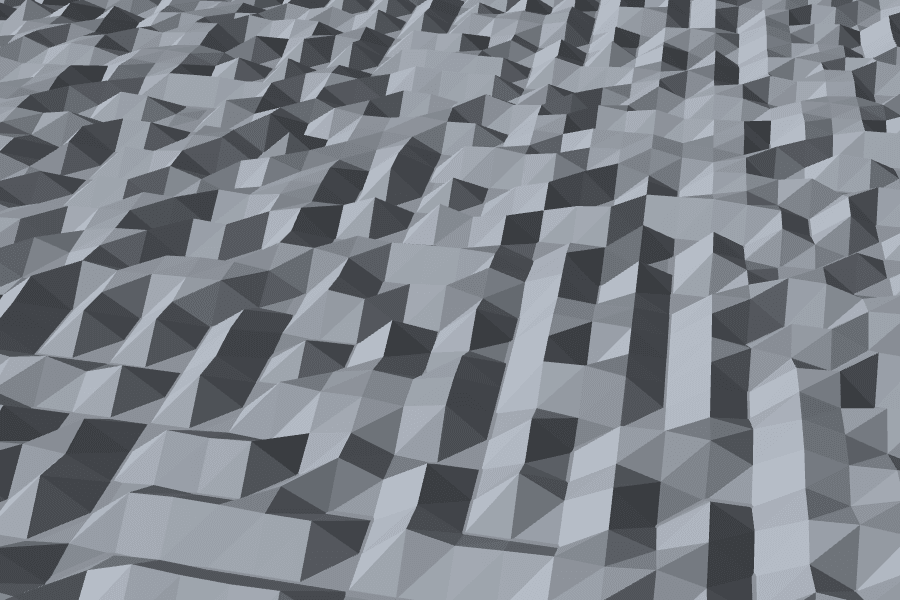
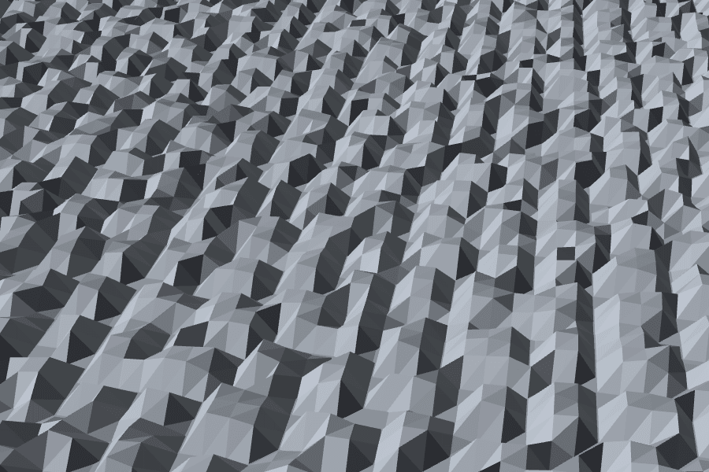
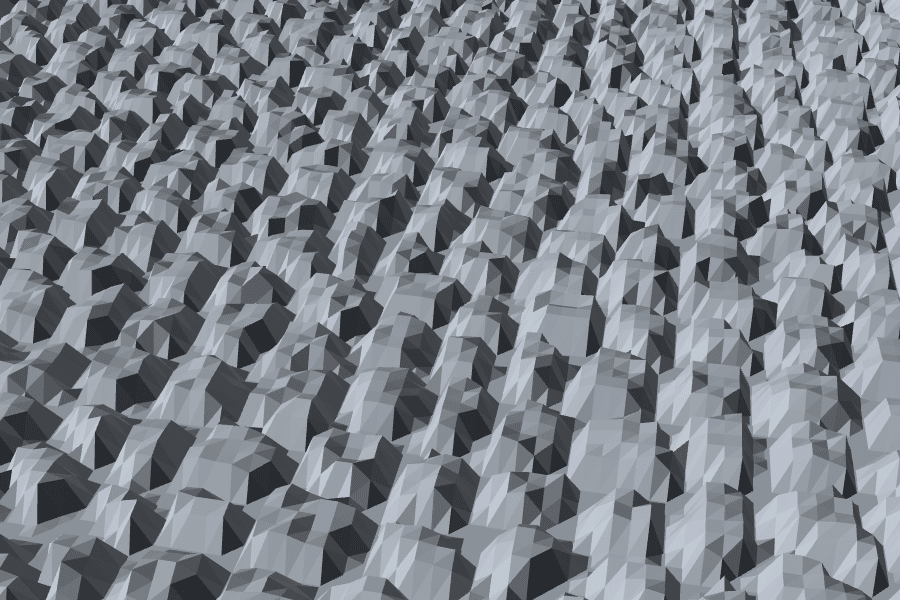
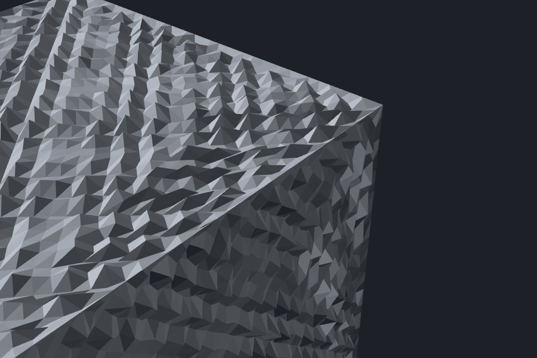
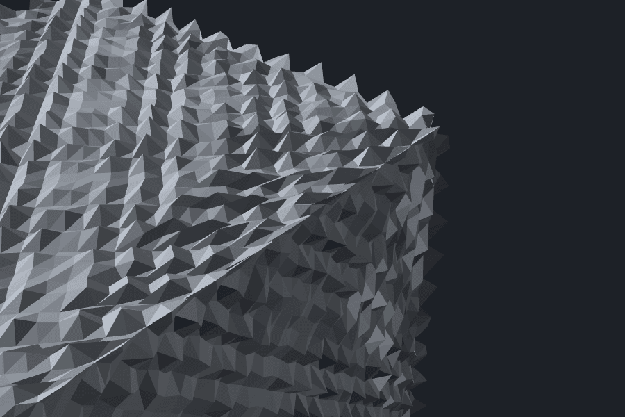
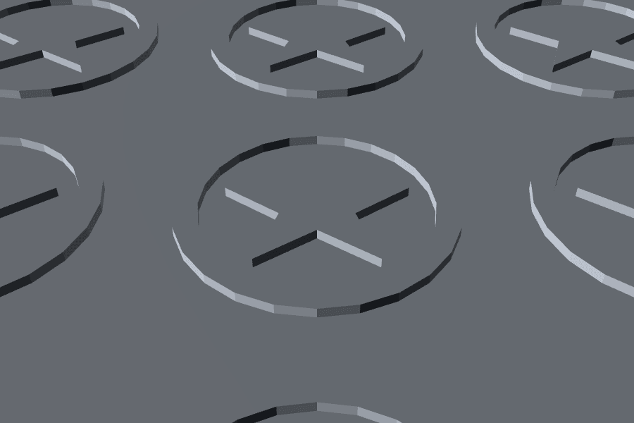
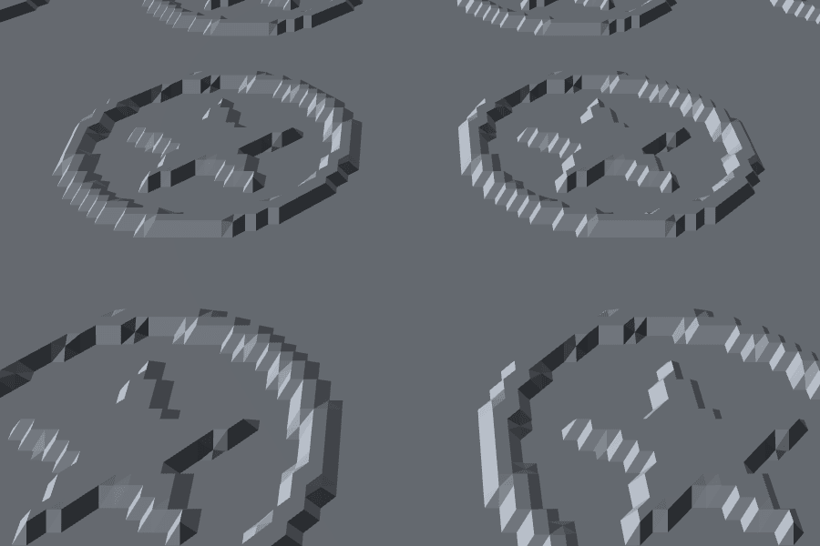

# Studio di fattibilità: texture da immagine (JPG, PNG, SVG) come superficie in rilievo

Data: 23 ottobre 2026. Domanda: si può applicare a un oggetto di Construct una **texture da immagine** (una foto di pelle, una zigrinatura, un
logo SVG) per produrre una superficie in rilievo, come fanno il modificatore Displace di Blender e BumpMesh di CNC Kitchen, mantenendo tempi da
editor interattivo, la rigenerazione deterministica e il codice OpenSCAD esportabile? Lo studio ricalca quello dei rilievi procedurali
(`docs/studio-pattern-rilievo.md`) e finisce con un confronto tra le due soluzioni.

**Esito: fattibilità alta per le facce piane (motore F, riuso quasi totale del codice dei rilievi), media per la mesh intera (motore M, con limiti
chiari sugli spigoli e sull'ampiezza), alta per l'SVG vettoriale quando basta una quota sola.** Il prototipo (solo studio, **non collegato all'app**)
calcola entrambi i motori nel kernel, scrive il codice OpenSCAD e il volume del solido esportato coincide con quello del kernel (verificato con
OpenSCAD, vedi più sotto). Raccomandazione in fondo: **soluzione ibrida**, procedurale/CSG per i casi geometrici (mattoni, borchie, fughe), immagine per
il resto, e il motore M solo come funzione a parte con avvertenze.

## Cosa c'è nel prototipo

| File | Contenuto |
|---|---|
| `src/scene/textureMap.ts` | Calcoli puri e deterministici: da RGBA a grigio con formula intera, riduzione e sfocatura, campionatore bilineare, quota (livello medio, ampiezza, modi rilievo, incavo, entrambi), scala in mm per piastrella, rotazione, scostamento, inversione, ripetizione; proiezioni planare, triplanare e cilindrica |
| `src/scene/textureSamples.ts` | Sei texture di esempio generate nel codice (zigrinatura, fibra di carbonio, pelle, mattoni, onde, rumore) e un SVG di prova |
| `src/kernel/textureMap.ts` | Motore F (`faceSurface`, `applyTextureFace`), motore M (`displaceSolid`, `selfOverlapVolume`), SVG vettoriale (`svgReliefSolid`), chiave di cache per impronta (`textureCacheKey`) |
| `src/codegen/textureScad.ts` | Codice OpenSCAD: `zmap` (motore F), `surface()` con PNG, `polyhedron` (motore M), `polygon` per l'SVG |
| `src/scene/textureMap.test.ts`, `src/kernel/textureMap.test.ts`, `src/codegen/textureScad.test.ts`, `src/kernel/textureCore.test.ts` | Test: determinismo, valori ai bordi, ripetizione, inversione, rotazione, validità dei solidi (`NoError`, volume, un solo solido), volume uguale all'integrale della quota, cubo, cilindro e pannello del motore M, SVG, chiave di cache, CORE del prototipo uguale ai sorgenti |
| `src/kernel/bench.test.ts` | In coda, dietro `BENCH=1`: righe immagine nella stessa tabella dei rilievi, peso delle immagini, rischi del motore M |
| `docs/prototipi/texture-immagine.html` | Prototipo in un file solo (tema chiaro e scuro, manifold-3d 3.5.4 e three 0.186.1 da jsDelivr) |
| `scripts/texture-core.mjs`, `scripts/texture-prototype-check.mjs`, `scripts/texture-decode-check.mjs`, `scripts/texture-render.mjs` | Generazione del blocco CORE dell'HTML dai sorgenti, prova del prototipo in Chrome, misura della decodifica delle immagini, foto degli STL |
| `docs/studio-texture/` | Immagini PNG (schermate del prototipo e foto degli STL, circa 1,7 MB). Gli STL non sono nel repository |

L'unica modifica a file dell'altro studio è l'aggiunta di `export` a `ABOVE`, `EMBED`, `FLOOR`, `prism`, `clipToRegion` (in `src/kernel/relief.ts`) e a
`polyhedronLines` (in `src/codegen/reliefScad.ts`). Come per i rilievi, tutto lavora nel **riferimento della faccia** (faccia su z = 0, pezzo sotto) e
riceve la regione come `CrossSection`; il chiamante possiede regione e solidi.

## Come lo fanno gli altri

**Blender, modificatore Displace** (descrizione dalla conoscenza del programma: la pagina del manuale non si è caricata in questa sessione, vedi la lista
di ciò che non è verificato). Sposta ogni vertice della mesh di `(valore della texture − Midlevel) × Strength`, lungo la normale del vertice (oppure
lungo X, Y, Z, o con la direzione presa dai colori RGB). Il valore 0,5 di grigio è il livello medio: bianco sale, nero scende. Le coordinate della texture
sono le UV, oppure le coordinate locali, globali, di un oggetto o della mesh originale. Serve **una mesh già abbastanza fitta** (Subdivision Surface o
Subdivide prima del Displace): il modificatore sposta solo i vertici che ci sono. Un gruppo di vertici può mascherare l'effetto. Agli spigoli vivi
usa le normali dei vertici (mediate), quindi lo spigolo si sposta in diagonale.

**BumpMesh (stlTexturizer)**, dal README del progetto (https://github.com/CNCKitchen/stlTexturizer): programma nel browser, nessun dato va in rete.
Proiezioni: triplanare (predefinita, "migliore per forme complesse"), cubica con fusione alle cuciture, cilindrica con angolo del tappo, sferica,
planare XY, XZ, YZ; scala U/V, scostamento U/V, rotazione. **Ampiezza** da 0 a 100 %, spostamento **simmetrico** (50 % di grigio neutro, bianco verso
fuori, nero verso dentro, "preserva il volume"); un avviso compare quando la profondità supera il 10 % della dimensione minima del modello. Suddivisione
**adattiva** fino a una lunghezza target del lato, con rispetto degli spigoli (angolo diedro oltre 30 gradi), decimazione QEM, tetto di sicurezza a 10 milioni
di triangoli. Maschere per angolo (togliere la texture sulle facce quasi orizzontali) e pennello. 101 texture incluse, **immagine personalizzata** come mappa di
spostamento con sfocatura facoltativa; fino a quattro livelli per modello. Ingresso STL, OBJ, 3MF, STEP; uscita STL binario. Il README non descrive la
matematica delle normali.

**OpenSCAD `surface(file = "x.png")`**: legge nativamente un PNG (oppure un file di numeri) e produce un solido chiuso. Vedi la rivalutazione qui sotto.

### `surface()` rivalutato

Il primo studio lo aveva scartato perché richiede un file esterno e rompe l'export in un solo file. Con una texture da immagine il file esterno esiste comunque
(l'immagine), quindi la domanda vale la pena. **Provato davvero con OpenSCAD 2025.11.30** (backend Manifold) con un PNG asimmetrico di 4 × 3 pixel e valori
noti, e poi con la griglia di una faccia di 80 × 60 mm.

- **Mappatura misurata.** Il nodo (colonna i, riga dal basso j) sta in (i, j): **y = 0 è l'ultima riga del PNG** (il PNG appare capovolto rispetto a come lo si
  guarda), i pixel sono nodi e non celle, quindi un'immagine di w × h pixel copre (w − 1) × (h − 1) unità. L'altezza va da 0 a 100 per il grigio da 0 a 255
  (`gray / 255 × 100`). `invert = true` non fa 100 meno il valore: **cambia segno** e porta il fondo a −100,6 (il valore di partenza diventa −(gray − 1)/255 × 100).
- **Il fondo del solido sta a (quota minima − 1)**, non a zero: in un PNG senza pixel neri il solido resta sottile e, se si toglie la colonna del pezzo
  (modo "entrambi"), resta un vuoto. La soluzione provata è una **cornice di un pixel a 0 fuori dal rettangolo** e un `intersection()` per ritagliare.
- **Nessuna ripetizione, rotazione, scala o ritaglio sulla regione**: tutto si deve "cuocere" nel PNG (griglia già campionata dal kernel) e poi scalare con
  `scale([passo, passo, ampiezza/100])`. In pratica il PNG non è più l'immagine dell'utente ma la mappa di altezze del kernel in 8 bit.
- **Triangolazione a ventaglio** (un nodo al centro di ogni cella): 4 triangoli per cella contro 2 della `zmap`. A 0,5 mm su 80 × 60: 77.300 triangoli in OpenSCAD
  contro 39.190.
- **Risultato.** Codice OpenSCAD di **0,4 KB** (contro 60 a 73 KB della `zmap` a 0,5 mm) più un PNG di 0,5 a 0,8 KB per la zigrinatura (163 × 123 pixel,
  molto comprimibile; una pelle è più pesante). Volume: scarto da −1,7 a +6,4 mm³ (0,007 a 0,03 %) rispetto al kernel nella stessa pelle (quantizzazione a 8 bit
  e triangolazione), contro 0,00 mm³ della `zmap`. Tempo di rendering 0,8 a 0,9 s, simile alla `zmap` (0,8 a 1,2 s).
- **Pro:** file `.scad` minuscolo e leggibile, si può aprire il PNG e cambiare la mappa a mano, il dato più compatto (1 byte per nodo). **Contro:** due file da
  tenere insieme (se il PNG non sta accanto, il rendering fallisce), orientamento invertito, fondo a min − 1, niente ritaglio né ripetizione, la quantizzazione a
  8 bit limita l'ampiezza utile (con 0,6 mm sono 0,0024 mm per livello: ok), un formato "grafico" che nasconde l'ampiezza dentro una `scale`.
- **Giudizio:** da offrire come **seconda opzione di export** per il motore F ("con file PNG a fianco", due scaricamenti o un archivio), non come predefinita.
  La predefinita resta la `zmap` in un file solo, già verificata a 0,00 mm³.

## Come si ricava la quota dall'immagine

Convenzioni fissate in `src/scene/textureMap.ts` (e provate dai test): immagine `w × h` a 8 bit, riga 0 in alto, il centro del pixel `(i, j)` sta in
`((i + 0,5) / w, (j + 0,5) / h)` della piastrella, l'asse Y della faccia va verso l'alto. Una piastrella è larga `tile` mm e alta `tile × h / w` mm.
Il campionatore è **bilineare**, con ripetizione (indici modulo `w` e `h`, quindi sul bordo si mescolano l'ultimo e il primo pixel) oppure, senza ripetizione, con
quota 0 fuori dalla piastrella. Rotazione antioraria attorno al punto di scostamento, inversione, sfocatura a scatola separabile (raggio in pixel).

| Modo | Quota (mm) con `v` grigio 0 a 1, `m` livello medio, `A` ampiezza | Intervallo |
|---|---|---|
| Entrambi (come Blender e BumpMesh) | `(v − m) × A` | da `−m A` a `(1 − m) A` |
| Rilievo | `max(0, v − m) / (1 − m) × A` | da 0 ad A |
| Incavo | `−max(0, m − v) / m × A` | da −A a 0 |

Con `m` agli estremi la divisione non avviene (quota 0), i parametri hanno limiti obbligatori (`normalizeTexture`: scala da 0,5 mm, ampiezza al più 20 mm,
sfocatura al più 20 pixel, valori non finiti riportati al valore di partenza).

**Grigio.** Formula **intera sui valori sRGB come sono**, senza linearizzare e senza profilo colore: `Y = (77 R + 150 G + 29 B + 128) >> 8` (pesi di Rec. 601
arrotondati, somma 256, il bianco resta 255; il rosso puro dà 77, il verde 149, il blu 29). I pixel semitrasparenti si compongono prima sul **bianco** (la carta),
con aritmetica intera; con `invert` si cambia verso. Scelta documentata e provata (vedi la sezione sul determinismo): è la stessa per ogni browser, a parità dei
canali RGBA decodificati.

## Motore F: faccia piana

L'immagine campionata è la `f(x, y)` di `sampleGrid`; la griglia passa a `heightSolid` come per i rilievi procedurali. Cambia solo **cosa si fa del solido**,
perché la quota ha anche il segno: `faceSurface` sceglie una di tre operazioni.

- **Incavo (`subtract`)**: solido sopra la superficie `FLOOR + h` fino a 1,5 mm sopra la faccia, ritagliato sulla regione e tolto dal pezzo (come `depthMapCutter`).
- **Rilievo (`add`)**: solido sotto la superficie `max(h, −FLOOR)` che entra di `EMBED` = 0,2 mm nel pezzo, unito (come le borchie, `reliefAddition`).
- **Entrambi (`skin`)**: la quota cambia segno e un solo solido non basta. Si toglie dal pezzo la **colonna** della regione fino a 0,4 mm sotto l'incavo più
  profondo e si unisce la "pelle" (superficie intera chiusa 0,2 mm più in basso): **due booleane** invece di una. Provata su pannello e cilindro (il ritaglio su una regione ridotta solo in modo rilievo).
  Il primo schema, con un cutter e una addizione indipendenti, ricoprirebbe gli incavi (l'addizione entra di 0,2 mm sotto la faccia): scartato senza misurarlo.

Il volume del solido risultante coincide con l'integrale esatto della quota sulle facce della griglia (test, tolleranza 0,2 %); rilievo e incavo non superano mai
la faccia più di `A` e di 0 rispettivamente. Il passo ha un tetto di 250.000 nodi (quello di `sampleGrid`) e i valori della griglia sono arrotondati al centesimo
di mm: con ampiezze piccole i livelli visibili sono pochi (0,6 mm danno 60 livelli, 0,2 mm solo 20).

### Misure (faccia 80 × 60 mm su pannello di 5 mm)

Stessa procedura e stesse colonne del primo studio: mediana di 7 esecuzioni (più 2 di riscaldamento) di costruzione del solido, booleana sul pannello ed
estrazione della mesh; STL = 84 + 50 byte per triangolo; codice OpenSCAD = lunghezza della stringa del modulo (quote in centesimi interi). **I tempi variano fino a
circa ±30 %** e nella sessione di questa misura il computer era più carico che nel primo studio (le stesse righe procedurali, rieseguite, sono più lente del 30
a 50 % rispetto al primo documento): contano l'ordine di grandezza e i rapporti. Parametri: scala 20 mm per piastrella, ampiezza 0,6 mm, immagine di 256 × 256
pixel. Comando: `$env:BENCH='1'; $env:BENCH_OUT='bench.txt'; npx vitest run src/kernel/bench.test.ts -t "texture in rilievo"`.

| Immagine (motore F) | Modo | Passo | Tempo (ms) | Triangoli | STL (KB) | OpenSCAD (KB) |
|---|---|---|---:|---:|---:|---:|
| Pelle | rilievo | 0,8 | 153 | 32.068 | 1.566 | 24 |
| Pelle | rilievo | 0,5 | 468 | 77.666 | 3.792 | 58 |
| Pelle | rilievo | 0,3 | 1.310 | 182.254 | 8.899 | 158 |
| Zigrinatura | rilievo | 0,8 | 121 | 15.500 | 757 | 24 |
| Zigrinatura | rilievo | 0,5 | 204 | 33.832 | 1.652 | 59 |
| Zigrinatura | rilievo | 0,3 | 600 | 56.976 | 2.782 | 157 |
| Pelle | incavo | 0,5 | 366 | 66.276 | 3.236 | 53 |
| Pelle | entrambi | 0,5 | 170 | 39.438 | 1.926 | 63 |
| Rumore (caso peggiore per la compressione) | rilievo | 0,5 | 516 | 77.494 | 3.784 | 57 |

Letture:

- **I triangoli del rilievo dipendono da quanta area sporge.** La pelle è chiara quasi ovunque, quindi quasi tutta la superficie sta sopra la faccia e sopravvive
  alla booleana (32.000 a 0,8 mm); la zigrinatura è per metà sotto il livello medio, quella parte resta dentro il pannello e sparisce (15.500). Il modo "entrambi"
  ha 39.400 triangoli perché il pannello perde la parte alta della colonna.
- **Il tempo cresce con 1/passo²** come per la mappa di altezze procedurale, ma con più triangoli: una texture da immagine ha dettaglio dappertutto, i rilievi
  procedurali no. A 0,8 mm (anteprima) sono 120 a 150 ms su questa macchina; nel prototipo in Chrome, con la stessa 80 × 60 e passo 0,8, 46 a 91 ms.
- **Il codice OpenSCAD** è quello della `zmap` (24 KB a 0,8, 58 a 0,5, 158 a 0,3 mm): dipende dai nodi, non dall'immagine. Il PNG sorgente non c'entra.
- **Il passo dev'essere comparabile al pixel.** A 20 mm per piastrella e 256 pixel un pixel è 0,078 mm: il passo di 0,3 a 0,8 mm lo campiona molto
  più grossolano e, per immagini con dettaglio fine, **fa aliasing** (moiré). Rimedio proposto (non implementato): sfocare di circa `passo / (2 × pixel)`
  pixel prima del campionamento, o ridurre l'immagine a un pixel pari al passo.

Foto degli STL della pelle in rilievo a 0,8, 0,5 e 0,3 mm (luce radente, vista ravvicinata, normali piatte per mostrare la griglia). A 0,8 mm la griglia
si vede, a 0,3 mm la superficie è già vicina all'immagine.

## Motore M: mesh intera, stile Blender e BumpMesh

### Che cosa offre davvero manifold-3d 3.5.4

Prima di progettare si è provato con un piccolo script (cubo di 30 mm, `refineToLength(1)`, 13.836 triangoli) e letto `manifold.d.ts`.

| Funzione | Risultato della prova |
|---|---|
| `refineToLength(L)` | Funziona senza tangenti: divide gli spigoli (anche di facce piane) in pezzi lunghi circa `L`, aggiunge vertici interni e restituisce `NoError`. Cubo di 30 mm a L = 1: 14 ms. Il tempo è lineare nei triangoli (pannello 80 × 60 × 5 a 0,8 mm: 33 a 43 ms; a 0,3 mm: 153 ms). La stima di circa 0,4 L² di superficie per triangolo ha permesso un tetto dei triangoli |
| `refine(n)` | Ogni spigolo in `n` parti (n = 8: 768 triangoli): non adatta la lunghezza al modello |
| `warp(f)`, `warpBatch(f)` | La funzione riceve **solo la posizione** (`warp`) o un array piatto `xyz` (`warpBatch`), per i **vertici unici** (cubo raffinato: 6.920 su 6.920): un vertice geometrico si sposta una volta sola. Quindi con `warp` non si possono aprire fessure tra facce, e per sapere la normale in ogni punto serve una tabella calcolata prima. **`status()` resta `NoError` anche quando la superficie si sovrappone**: il controllo è solo topologico (la documentazione lo dice: "it is up to the user to choose their function with discretion") |
| `calculateNormals(0, angolo)` | Aggiunge tre proprietà per vertice (`numProp` 6) e **duplica le righe di `getMesh()` sugli spigoli** (7.296 righe contro 6.920 vertici sul cubo raffinato, con o senza angolo). Utile per un renderer, ma le righe non coincidono con i vertici di `warpBatch` e non si può usare per spostare in modo controllato |
| `setProperties(n, f)` | Crea proprietà per vertice (`numProp` 7 nella prova): non sposta la geometria |
| `new Manifold(mesh)` | Con una mesh **aperta** (vertici staccati) **lancia `ManifoldError: Not manifold`** invece di restituire uno stato: la costruzione va in `try`/`catch` |

Da qui la scelta: **normali e spostamenti calcolati in JavaScript sulla mesh di `getMesh()`**, nuova `Mesh` con le posizioni spostate e `new Manifold(mesh)`
(`displaceSolid` in `src/kernel/textureMap.ts`). Così le varianti sono nostre e misurabili. Passi: raffinamento a lato massimo `edge` (tetto di 400.000 triangoli,
oltre si allarga il lato), normali di faccia e normale media del vertice **pesata per l'angolo**, spostamento `h(p, n)` lungo la direzione scelta (la
quota è quella delle proiezioni di `makeDisplacement`), ricostruzione. Controlli aggiuntivi che `status()` non fa: **triangoli rovesciati** (la normale del
triangolo dopo lo spostamento ha prodotto scalare negativo con quella di prima) e **sovrapposizione** (`selfOverlapVolume`: volume dell'unione del solido con se stesso
meno il suo volume, nullo se la superficie è valida; il rumore a 32 bit arriva a circa 0,05 mm³, quindi sotto 0,1 mm³ vale zero).

### Varianti delle normali agli spigoli

- **Medie** (come Blender): lo spigolo si sposta in diagonale, il cubo si **arrotonda e si deforma** agli spigoli (fotografia sotto, a sinistra).
- **Squadrate (miter)**: sugli spigoli vivi la direzione che sposta di `h` ogni piano adiacente (`(n1 + n2) / (1 + n1 · n2)`, tetto 2 h). Sulle facce sposta bene,
  ma sul vertice di spigolo la quota unica `h` vale per due piani diversi: **non ha dato risultati migliori** (anzi, più triangoli rovesciati, vedi tabella).
- **Separate per faccia**: ogni triangolo con vertici propri e normale propria. Le facce si staccano agli spigoli e **manifold rifiuta la mesh** in tutti i casi
  provati (cubo, pannello, cilindro, L, scatola, ampiezze 0,6 a 2 mm). Metodo **non utilizzabile** così: per chiudere le fessure servirebbe un nastro di triangoli
  lungo ogni spigolo (non implementato).
- **Spigoli fermi** (`fadeSharp`, analogo delle maschere angolari di BumpMesh e della soglia di 30 gradi): sui vertici dove due facce vicine formano un angolo
  diedro oltre 30 gradi l'ampiezza è **0**; la texture sfuma verso lo spigolo nel giro di un lato di triangolo. Lo spigolo resta esatto.

Cubo di 30 mm, zigrinatura a rombi, ampiezza 1,2 mm, lato 0,8 mm, triplanare: normali medie (lo spigolo e l'angolo escono dal profilo e si sfrangiano), spigoli
fermi (spigolo dritto), squadrate (simili alle medie).

### Misure: rischio per solido e per ampiezza

Cinque solidi: pannello 80 × 60 × 5 (triplanare), cilindro Ø30 × 40 (**proiezione cilindrica** con tappi planari), cubo 30 mm (triplanare), **profilo a L**
40 × 40 × 10 con parete 10 × 40 × 40 e **scatola** 40 × 40 × 20 con cavità 30 × 30 (per gli **spigoli concavi**). Zigrinatura (scala 10 mm), modo "entrambi", lato
0,8 mm. Per ogni variante: triangoli rovesciati / sovrapposizione in mm³ a tre ampiezze (0,6 · 1,2 · 2 mm; lo spostamento massimo è la metà dell'ampiezza).
`status()` è `NoError` in **tutte** le righe tranne "separate" (errore). Comando: `-t "rischi del motore M"`.

| Solido | Medie | Medie + spigoli fermi | Squadrate | Squadrate + spigoli fermi |
|---|---|---|---|---|
| Pannello | 8 / −0,02 · 48 / −0,09 · 224 / −11,6 | 0 / −0,02 · 0 / −0,03 · 0 / −11,1 | 16 / −0,03 · 124 / −0,18 · 548 / −13,9 | 0 · 0 · 0, come le medie |
| Cilindro | 44 / −0,04 · 90 / −0,50 · 332 / −7,1 | 0 / −0,02 · 0 / −0,33 · 192 / −5,3 | 56 · 110 · 514 / −8,1 | come le medie con spigoli fermi |
| Cubo | 0 / 0,00 · 60 / −0,23 · 228 / −21,0 | 0 / 0,00 · 0 / −0,58 · 0 / −26,3 | 36 / 0,00 · 144 / −0,32 · 372 / −22,5 | come le medie con spigoli fermi |
| L (concavo) | 0 / 0,00 · 42 / −0,02 · 121 / −10,2 | 0 / 0,02 · 0 / −0,01 · 0 / −8,8 | 4 / 0,00 · 92 / −0,04 · 415 / −11,0 | come le medie con spigoli fermi |
| Scatola (concavo) | 0 / 0,00 · 42 / −0,07 · 188 / −12,7 | 0 / 0,00 · 0 / −0,01 · 0 / −11,2 | 6 / 0,00 · 126 / −0,12 · 606 / −14,0 | come le medie con spigoli fermi |

Letture:

- **Sotto 0,6 mm di ampiezza (spostamento massimo 0,3 mm, meno della metà del lato di 0,8 mm) tutto è valido**, con spigoli fermi; senza spigoli fermi restano pochi triangoli rovesciati su pannello (8) e cilindro (44), senza sovrapposizione misurabile. A 1,2 mm cominciano i triangoli rovesciati dei metodi senza spigoli
  fermi e una sovrapposizione piccola ma reale (da −0,3 a −0,6 mm³). A 2 mm la sovrapposizione è di 5 a 26 mm³ **in tutte le varianti, anche con gli spigoli fermi**,
  e `status()` non se ne accorge. **Regola proposta: spostamento massimo (metà dell'ampiezza nel modo "entrambi") non oltre circa la metà del lato dei triangoli**; BumpMesh
  usa una regola diversa (avviso oltre il 10 % della dimensione minima del modello) e raffina in modo adattivo, qui il raffinamento è uniforme.
- **Gli spigoli concavi non hanno dato problemi aggiuntivi** a ampiezze valide (L e scatola si comportano come cubo e pannello): in un angolo concavo gli spostamenti
  verso l'esterno dei due piani si avvicinano, ma il metodo con lo spigolo fermo e lo spostamento ridotto dentro un lato di triangolo non ha prodotto autointersezioni
  misurabili sotto i limiti sopra. Resta il rischio in angoli molto acuti o con rientranze strette (non provate).
- **Con le normali medie senza spigoli fermi l'ingombro cambia agli spigoli** (la crescita misurata del riquadro è la stessa ovunque, 0,28 mm a 0,6 di ampiezza, ma la forma dello
  spigolo no, vedi la fotografia): per un pezzo che deve incastrarsi i bordi sono da tenere fermi.
- **Le squadrate non migliorano le medie**: più triangoli rovesciati in tutti i solidi. Si propone di non implementarle.
- **Il volume cambia come l'integrale della quota** sulle facce: sul cubo, scarto tra il volume del kernel e quello atteso (integrale su 300 × 300 punti per sei facce) entro l'8 % (tolleranza del test, scarto effettivo non riportato)
  (test), perché le fasce accanto agli spigoli restano a zero. Con la zigrinatura e il livello medio 0,5 il pezzo **perde volume** (media del grigio 0,33): il livello medio è
  da tarare.

### Costo del motore M

Il tempo comprende raffinamento, normali, spostamento, ricostruzione ed estrazione della mesh (**tutto l'oggetto**: i triangoli non sono confrontabili 1 a 1 con quelli del
motore F, che tocca una faccia sola). Pelle, ampiezza 0,6 mm, "entrambi", spigoli fermi, normali medie.

| Oggetto | Lato (mm) | Tempo (ms) | di cui raffinamento | Triangoli | STL (KB) | OpenSCAD (KB) |
|---|---:|---:|---:|---:|---:|---:|
| Pannello 80 × 60 × 5 | 0,8 | 145 | 43 | 40.380 | 1.972 | 1.165 |
| Pannello | 0,5 | 305 | 74 | 101.564 | 4.959 | 3.033 |
| Pannello | 0,3 | 705 | 153 | 275.564 | 13.455 | 8.570 |
| Cubo 30 | 0,8 | 49 | 12 | 21.408 | 1.045 | 587 |
| Cubo 30 | 0,5 | 115 | 29 | 53.580 | 2.616 | 1.573 |
| Cilindro Ø30 × 40 (cilindrica) | 0,8 | 125 | 35 | 42.784 | 2.089 | 1.242 |
| Cilindro | 0,5 | 186 | 47 | 66.764 | 3.260 | 1.974 |

Il costo cresce con l'area totale e con 1/lato²; il codice OpenSCAD è un `polyhedron` con tutti i punti e tutte le facce (coordinate a tre decimali): **da 0,6 a 8,6 MB**.
Il volume coincide con quello del kernel entro 0,00 mm³ (cubo, pannello, cilindro), ma a questa dimensione è un esercizio di verifica, non un export praticabile.
Nel prototipo in Chrome: pannello 100 ms, cilindro 73 ms, cubo 49 ms a 0,8 mm.

### Dove il motore M fallisce o va limitato

1. **Ampiezza**: oltre circa metà lato di spostamento massimo la superficie si sovrappone senza che manifold lo segnali (servono `flipped` e `selfOverlapVolume`).
2. **Spigoli**: senza vertici fermi si arrotondano e si sfrangiano; con le normali separate la mesh si rompe.
3. **Raffinamento uniforme**: una mesh con molti triangoli piccoli o già fitta cresce senza controllo (tetto 400.000); BumpMesh raffina in modo adattivo e rispetta gli spigoli.
4. **Facce piccole, superfici sottili e pareti** sotto il doppio dell'ampiezza: le due superfici di una parete si possono incrociare (non misurato su pareti sottili).
5. **Perdita della catena parametrica** in OpenSCAD (solo `polyhedron` da megabyte) e peso nel progetto: l'operazione va tenuta come nodo con i parametri e ricalcolata (il risultato non si salva).
6. **Facce rivolte al piatto e sbalzi** nella stampa (vedi la sezione FDM).

## SVG in due modi

L'SVG di prova è uno stemma (anello e stella, `SAMPLE_SVG`), portato a 16 × 16 mm per piastrella con passo 20 mm, rilievo di 0,6 mm, su 80 × 60 mm.

**(a) Strada vettoriale.** `parseSvg` (già esistente, ha bisogno del DOM: thread principale, o `happy-dom` nei test) dà i contorni, `svgContours` li porta in mm, una `CrossSection`
con riempimento pari-dispari viene copiata nei centri delle piastrelle (`CrossSection.compose`, senza booleane quando le copie sono disgiunte), ritagliata sulla regione ed
estrusa come le celle dei mattoni (`svgReliefSolid`). **Bordi esatti, un solo livello di quota.** Il codice OpenSCAD è un `polygon(points, paths)` più un ciclo sui centri.

**(b) Rasterizzazione a scala di grigi.** L'SVG si disegna in un canvas (qui, in Node, con `sharp`/librsvg al posto del canvas del thread principale), si converte a grigio con
la formula intera e si usa come qualunque immagine nel motore F (livello medio 0,5, `invert`). **Sfumature possibili**, bordi a gradini della griglia.

| Strada | Passo | Tempo (ms) | Triangoli | STL (KB) | OpenSCAD (KB) | Note |
|---|---:|---:|---:|---:|---:|---|
| Vettoriale (celle estruse) | | 13 | 3.078 | 150 | 1,8 | volume = OpenSCAD entro 0,00 mm³ (rilievo e incavo), rendering 0,2 s |
| Raster 256 px, motore F | 0,8 | 62 | 6.680 | 326 | 24 | rasterizzazione e grigio: 13 a 28 ms (Node, sharp) |
| Raster 256 px | 0,5 | 167 | 13.858 | 677 | 59 | |
| Raster 256 px | 0,3 | 433 | 35.314 | 1.724 | 160 | |
| Raster 512 px | 0,8 | 73 | 6.712 | 328 | 24 | |
| Raster 512 px | 0,5 | 161 | 12.282 | 600 | 59 | |
| Raster 512 px | 0,3 | 387 | 32.538 | 1.589 | 160 | |

(I tempi hanno la variabilità del benchmark, circa ±30 %.) La differenza è di **5 a 30 volte in tempo, di 2 a 11 volte nei triangoli e di 13 a 90 volte nel
codice OpenSCAD** a favore della strada vettoriale; a parità di risoluzione dell'immagine (256 o 512 pixel) il raster non cambia in modo significativo, il vincolo è il passo
della griglia. Le fotografie qui sotto mostrano il bordo: netto e a spigoli con la vettoriale, a gradini di 0,5 mm con la raster.

Scelta: **offrire entrambe** quando l'immagine è un SVG, con la vettoriale come predefinita se i tracciati sono pieni e un solo livello basta (logo, sigla, marchio) e la raster quando serve
il grado di grigio (l'SVG con sfumature viene ignorato dalla vettoriale: `parseSvg` legge i tracciati riempiti e scarta quelli con `fill: none`). Limiti: il numero di punti
(`MAX_POINTS` di `parseSvg`), e il disegno ripetuto a passo fisso (nessuna rotazione né scostamento nel prototipo vettoriale, che sarebbero banali da aggiungere con `rotate` e `translate`).

## Asset e persistenza

**Oggi** `src/import/assets.ts` conosce solo le mesh: `MeshAsset {id, positions, indices}`, id = SHA-256 (primi 16 esadecimali) del contenuto, IndexedDB sotto `construct:asset:<id>`, codifica
per il file di progetto con zlib e base64 (`encodeAsset`); la scena tiene solo l'`assetId`, il kernel (worker) riceve la mesh con `registerAsset`, il ripristino (`restore.ts`)
la ri-registra. Non c'è alcuna gestione di immagini raster in `src` (nessun `createImageBitmap`, `OffscreenCanvas`, `getImageData`).

**Come si estende** (proposta, non implementata):

1. `ImageAsset { id, w, h, gray: Uint8Array }` accanto a `MeshAsset`, nello stesso registro o in uno parallelo (per non toccare il codice delle mesh). L'`id` è l'impronta SHA-256 di `w`,
   `h` e dei byte del **grigio già decodificato**, non del file. IndexedDB come per le mesh; codifica di progetto: intestazione (tipo, `w`, `h`) e zlib del grigio, base64.
2. **Decodifica una volta sola, all'importazione.** PNG e JPG con `createImageBitmap(blob, { colorSpaceConversion: 'none', premultiplyAlpha: 'none' })` e `OffscreenCanvas` **anche nel
   worker** (provato in Chrome: riesce); **SVG nel thread principale** con un elemento `img` e un canvas (nel worker fallisce: `InvalidStateError: The source image could not be decoded`).
   Poi `rgbaToGray` (formula intera) e `resizeGray` (media sull'area) fino a **512 pixel sul lato maggiore**.
3. Il kernel riceve il grigio con un metodo `registerImage(id, gray)` (buffer trasferito con `Comlink.transfer`) e lo tiene in una mappa; `restore.ts` lo ri-registra come le mesh.
4. **Chiave di cache del kernel per impronta, non per pixel**: `evaluate.ts` oggi fa `JSON.stringify(node.pattern)` (riga 93 circa); con `textureCacheKey(id, params, proiezione)` la chiave resta
   sotto i 300 caratteri e non scorre mai l'immagine (test). Il nodo porta solo `imageId` e i parametri.

**Peso nel file di progetto** (misurato; grigio a 8 bit; zlib livello 6 come `encodeAsset`; base64 = +33 %; PNG da `sharp` al livello 9 per confronto). Comando:
`-t "peso delle immagini"`.

| Immagine | Lato | Grezzo | zlib | base64 | PNG |
|---|---:|---:|---:|---:|---:|
| Zigrinatura (regolare) | 256 | 64 KB | 1,2 KB | 1,5 KB | 1,9 KB |
| | 512 | 256 KB | 3,4 KB | 4,5 KB | 7,3 KB |
| | 1024 | 1.024 KB | 10,1 KB | 13,5 KB | 23,4 KB |
| Onde (liscia) | 256 | 64 KB | 3,4 KB | 4,6 KB | 8,0 KB |
| | 512 | 256 KB | 10,6 KB | 14,2 KB | 25,9 KB |
| | 1024 | 1.024 KB | 37,3 KB | 49,7 KB | 99,7 KB |
| Pelle (organica) | 256 | 64 KB | 48 KB | 64 KB | 68 KB |
| | 512 | 256 KB | 165 KB | 220 KB | 230 KB |
| | 1024 | 1.024 KB | 507 KB | 676 KB | 695 KB |
| Rumore (caso peggiore) | 256 | 64 KB | 64 KB | 85 KB | 94 KB |
| | 512 | 256 KB | 256 KB | 341 KB | 373 KB |
| | 1024 | 1.024 KB | 1.024 KB | 1.366 KB | 1.486 KB |

Una foto di una superficie reale (pelle, legno, tessuto) sta tra la "pelle" e il "rumore". **Ridimensionamento massimo consigliato: 512 pixel sul lato maggiore**
(zlib da 165 a 256 KB, base64 da 220 a 341 KB nei casi duri: accettabile per un progetto, come una mesh importata di media grandezza); 1024 solo su richiesta, con un avviso. Più importante
del peso è il rapporto con il passo: **un pixel più piccolo di metà passo è ridondante** (a 0,5 mm di passo bastano 0,25 mm per pixel, cioè 80 mm per piastrella in 320 pixel), e con
immagini dettagliate serve una sfocatura prima del campionamento per non fare aliasing.

**Determinismo tra browser.** Misurato in Chrome contro Node (libvips e librsvg) con `node scripts/texture-decode-check.mjs`, immagine di 256 × 256 pixel, formula intera del
prototipo, tre modi di decodifica in Chrome (senza conversione, predefinito, elemento img):

| Immagine | Differenza massima | Pixel diversi |
|---|---|---|
| PNG grigio, PNG RGB, PNG con alfa | 0/255 in tutti i modi | 0 % |
| JPG qualità 90 e 60 | 0/255 in tutti i modi | 0 % |
| PNG con profilo Display P3 | 1/255 | 0,1 % (predefinito), 9,9 % (senza conversione di colore) |
| SVG (antialiasing del rasterizzatore) | **63/255**, media 0,23 | 2,3 % |

PNG e JPG coincidono con libvips alla nostra formula, **su questa macchina e in Chrome**: non è una garanzia per Firefox e Safari (altri decodificatori JPEG, altro trattamento del colore e
dell'alfa, **non provato**). Il profilo colore sposta al più un livello. L'SVG dipende dal rasterizzatore e **non è riproducibile tra motori**. Da qui la scelta che risolve tutto: **si salva e
si identifica con l'hash il grigio decodificato** (sorgente di verità del progetto), mai il file originale: dopo l'importazione il risultato è identico ovunque, e riaprire il progetto non rifà la
decodifica. Il file originale si può tenere come allegato facoltativo per rifare l'importazione.
